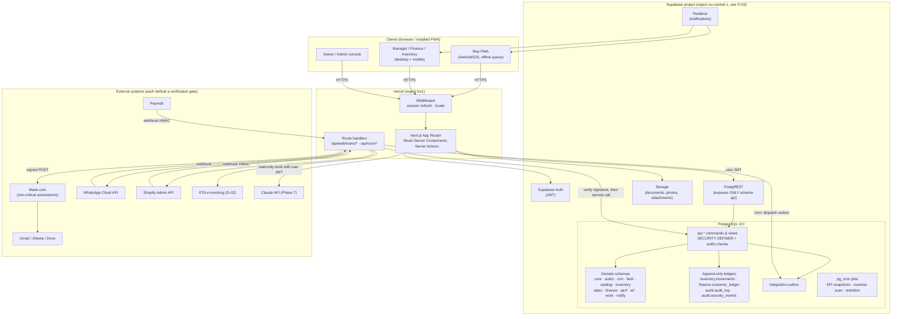
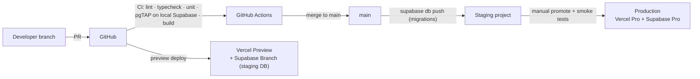
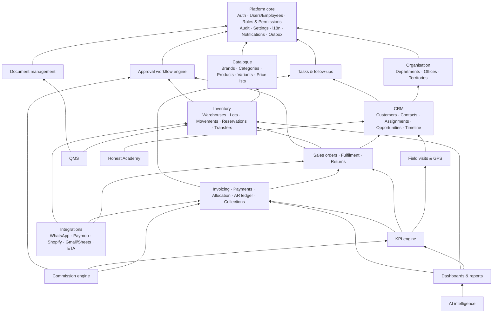
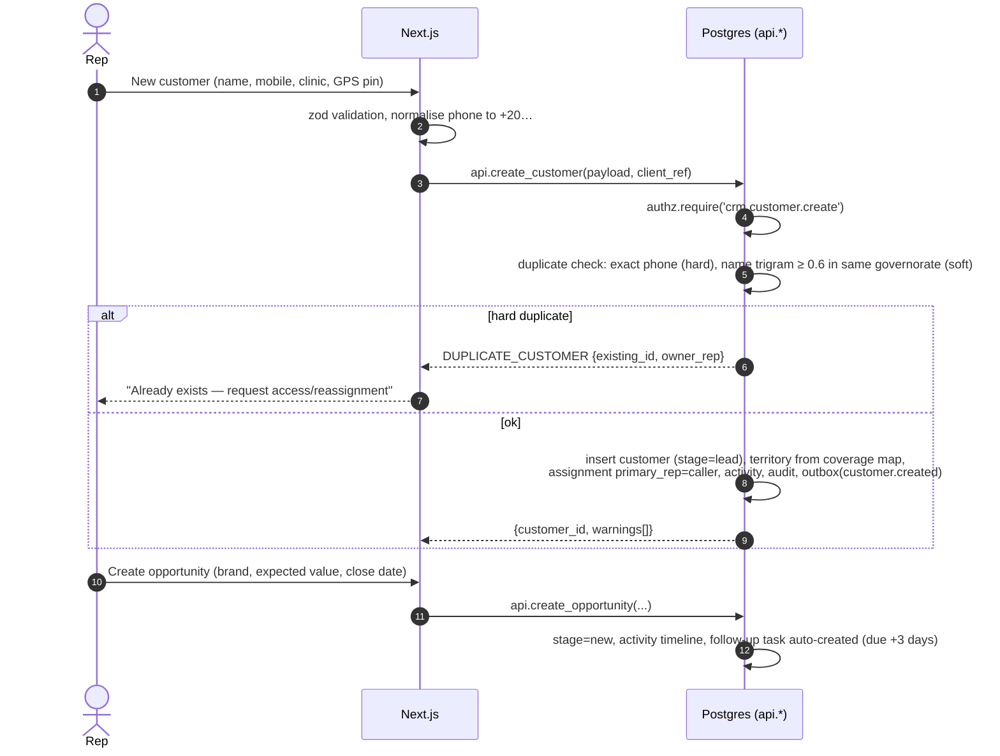
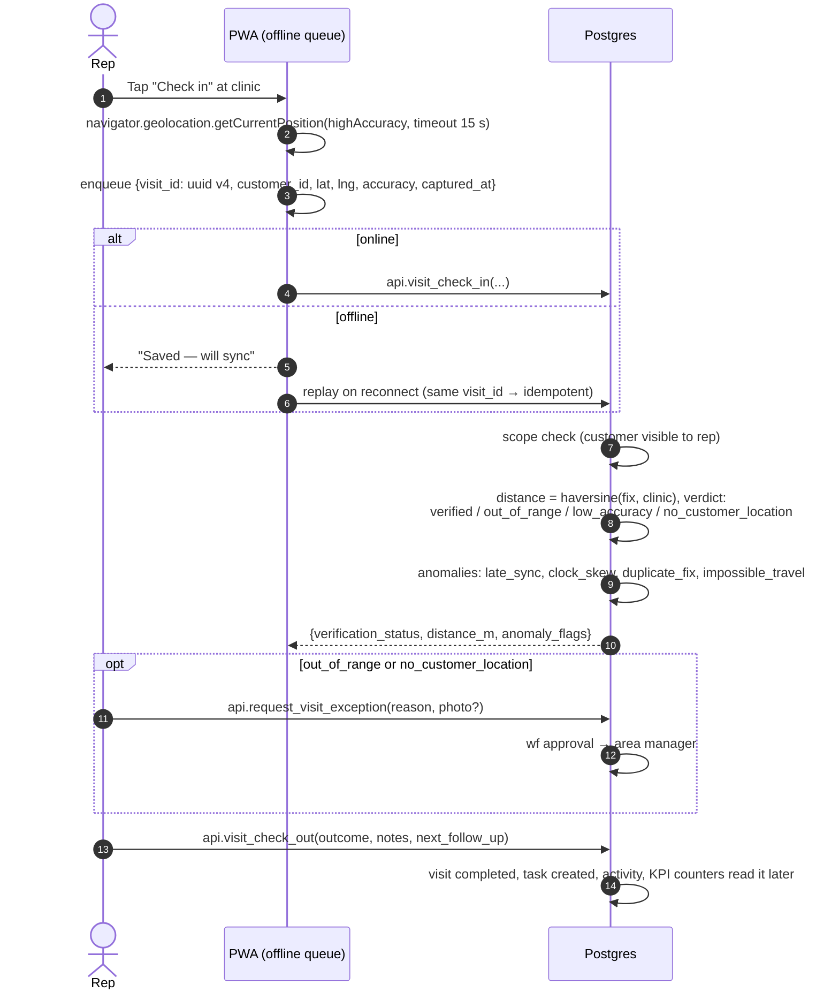
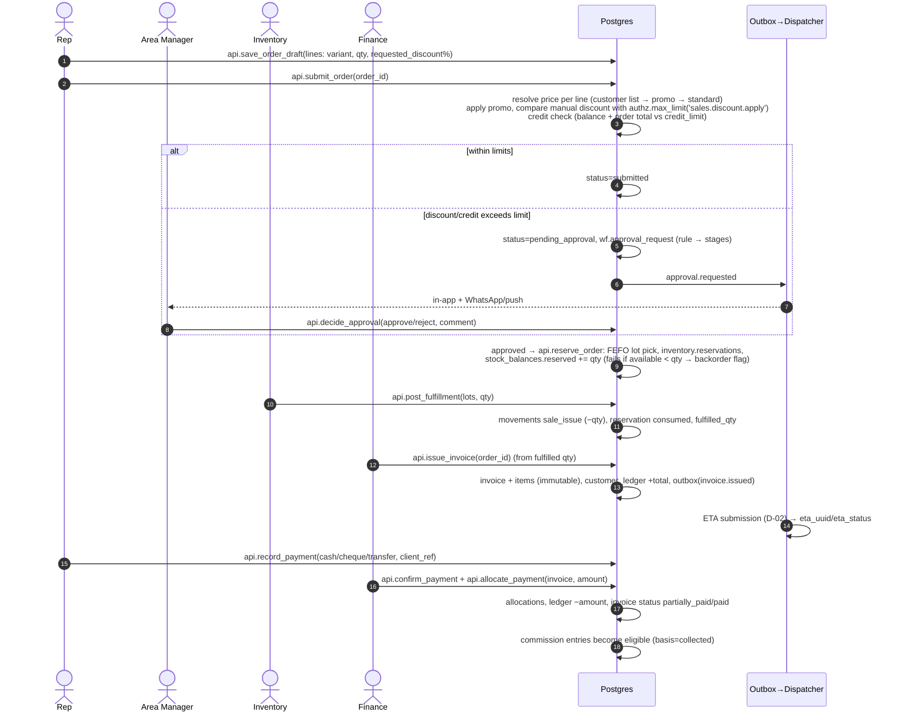
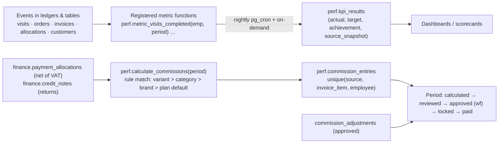

# System Architecture — Honest OS

> Status: **Proposed, awaiting approval** · Phase 1 deliverables #2 (architecture), #3 (data flow), #5 (module dependency map), #9 (error handling) · Last updated: 2026-10-28

---

## 1. Architecture at a glance

**Shape:** a **modular monolith**: one Next.js application and one PostgreSQL database, organised into domain modules with hard boundaries (one schema per module, one folder per module). Critical rules live in the database, where no client can bypass them.



### Security boundaries

| Boundary | Trust rule |
|----------|------------|
| Browser ↔ Next.js | The browser is **untrusted**. It holds only the user's session (httpOnly cookie) and the Supabase anon key, which is public by design. UI permission checks are cosmetic. |
| Next.js ↔ Postgres | Server code calls Postgres **with the user's JWT** by default, so RLS and `authz.*` checks apply. The service-role key is used only in `src/lib/supabase/admin.ts` (marked `server-only`): webhook ingestion, the outbox dispatcher and cron jobs. It is never imported by a component. |
| PostgREST surface | Only the `api` schema is exposed. Domain tables are reachable only through `api` views (security_invoker, RLS-filtered) and `api` functions (permission-checked commands). |
| Postgres ↔ external | Outbound: signed (HMAC-SHA256) payloads from the outbox, minimum data, no secrets. Inbound: signature verification first, raw payload stored, idempotent processing. |
| AI boundary (Phase 7) | The model never gets SQL or service credentials. It calls whitelisted read-only tools executed with the requesting user's JWT. |

---

## 2. Component structure

### 2.1 Repository layout (created in Phase 2)

```
honest-os/
├─ CLAUDE.md                     # working rules for AI-assisted development
├─ docs/                         # architecture, decisions, contracts (this folder)
├─ supabase/
│  ├─ config.toml
│  ├─ migrations/                # timestamped SQL; the ONLY way schema changes
│  ├─ tests/                     # pgTAP: RLS, ledgers, commands
│  └─ seed.sql                   # reference data + dev fixtures (never prod data)
├─ src/
│  ├─ app/
│  │  ├─ [locale]/(auth)/login/
│  │  ├─ [locale]/(rep)/today | customers | visits | orders | tasks | me
│  │  ├─ [locale]/(manage)/dashboard | team | pipeline | approvals | territories
│  │  ├─ [locale]/(inventory)/stock | receipts | transfers | adjustments | lots
│  │  ├─ [locale]/(finance)/invoices | payments | aging | collections | commissions
│  │  ├─ [locale]/(exec)/overview
│  │  ├─ [locale]/(admin)/users | roles | workflows | settings | audit | integrations
│  │  └─ api/
│  │     ├─ webhooks/{paymob,shopify,whatsapp}/route.ts
│  │     └─ cron/{outbox,kpi-snapshot,overdue-scan}/route.ts
│  ├─ modules/                   # one folder per domain; no cross-module imports of internals
│  │  └─ <module>/
│  │     ├─ server/commands.ts   # 'use server' actions → api.* RPC
│  │     ├─ server/queries.ts    # reads via api.* views
│  │     ├─ schemas.ts           # zod input schemas (shared client/server)
│  │     └─ components/
│  ├─ lib/
│  │  ├─ supabase/{server.ts,browser.ts,admin.ts}
│  │  ├─ errors.ts               # typed AppError mapping from Postgres error codes
│  │  ├─ i18n/                   # next-intl messages ar.json / en.json
│  │  ├─ offline/                # IndexedDB queue + sync engine
│  │  └─ observability.ts        # logger, request id, Sentry
│  └─ components/ui/             # shadcn/ui (RTL-safe, logical CSS properties)
├─ tests/
│  ├─ unit/                      # Vitest
│  └─ e2e/                       # Playwright (mobile + desktop projects)
└─ .github/workflows/ci.yml
```

### 2.2 Frontend

- **Next.js App Router with React Server Components.** Data is read on the server, so less JavaScript reaches cheap phones. Client components are used only where interaction needs them (check-in, order builder, offline queue).
- **Server Actions** call `api.*` RPCs with the user's session. Every action validates input with zod, adds an idempotency key and maps Postgres errors to typed `AppError`s.
- **PWA:** Web App Manifest plus a service worker (Serwist). The app shell and the rep's reference data (assigned customers, catalogue, price list snapshot) are cached for offline use.
- **i18n:** `next-intl`. Locale is in the URL (`/ar/...`, `/en/...`). `dir="rtl"` on `<html>` for Arabic. Tailwind logical properties (`ms-*`, `pe-*`) so one stylesheet serves both directions. `Intl.NumberFormat('ar-EG', {currency:'EGP'})`.
- **Design system:** shadcn/ui on Radix (accessible primitives), themed with Honest® brand tokens.

### 2.3 Backend

There are two layers with a strict division of labour:

| Layer | Owns | Never does |
|-------|------|-----------|
| **Postgres (`api.*` functions, triggers, constraints, RLS)** | Invariants: authorization, pricing, discount limits, state transitions, stock ledger, AR ledger, allocation rules, numbering, audit, outbox writes. One function = one transaction. | Network calls to third parties. |
| **Next.js server (actions, route handlers)** | Session handling, input validation, orchestration across commands, file uploads, calls to external APIs, webhook signature checks, the outbox dispatcher, AI orchestration. | Trusting client-supplied prices, totals, user ids or scopes. Writing to domain tables except through `api.*`. |

**Why rules live in Postgres (ADR-004):** the same rule then protects every entry point: UI, webhook, cron, a future mobile app, the AI layer, an admin running SQL through PostgREST. TypeScript-only rules can be bypassed by any path that skips the server code.

### 2.4 Authentication

- Supabase Auth with email + password and magic link. MFA (TOTP) is **required** for owner, admin and finance roles, enforced by checking the session's `aal2` level in `authz.is_active_user()` for sensitive permissions (Phase 2 task).
- **No public sign-up.** Users are created by an admin, linked to an `employees` row, and given roles.
- Session lives in an httpOnly cookie via `@supabase/ssr`. Access token about 1 h, refresh token rotation.
- Suspension sets `core.user_profiles.status='suspended'`. Every permission check fails immediately, because permissions are read from the DB on each request, not baked into the JWT (ADR-008). Sign-out of all sessions goes through the Auth admin API.

### 2.5 Authorization

The full model is in `docs/AUTHORIZATION.md`. In short: a permission catalogue, roles with **scoped** grants (`own`, `team`, `territory`, `department`, `warehouse`, `all`) and **limits** (discount %, EGP amount, units), per-user grant/deny overrides (deny wins), an owner role with implicit full access, and a database guard that keeps at least one active owner. RLS policies call `authz.*` helpers. Commands call `authz.require()` plus record-level checks.

### 2.6 Deployment



- Environments: `local` (Supabase CLI in Docker), `staging` (separate Supabase project, seeded with anonymised data), `production`.
- Migrations: forward-only SQL in `supabase/migrations`, applied by CI to staging and then, through a manual approval gate, to production. **Destructive migrations (drop/rename/narrowing types) need written owner approval** (CLAUDE.md rule 9) and an expand → migrate → contract sequence.
- Secrets: Vercel encrypted env vars (`SUPABASE_SERVICE_ROLE_KEY`, `PAYMOB_HMAC_SECRET`, `WHATSAPP_TOKEN`, `OUTBOX_SIGNING_SECRET`, `ANTHROPIC_API_KEY`), plus Supabase Vault for secrets that DB jobs need. None in Git. `.env.example` lists names only.

---

## 3. Technology decisions (why, alternatives, risks, scalability, security, cost)

| Decision | Why it fits | Alternatives considered | Risks introduced | Scalability | Security | Maintenance cost |
|----------|-------------|-------------------------|------------------|-------------|----------|------------------|
| **Modular monolith** (ADR-001) | One team, one product, strong cross-module transactions (order → stock → AR → commission) | Microservices; separate backend service (NestJS) + SPA | Module boundaries erode if not policed | Vertical scaling of Postgres + stateless Vercel functions easily covers ≤ 200 users. Modules can be split later along schema lines. | One trust boundary to secure instead of many | Lowest: one deploy, one DB, one CI |
| **Next.js (App Router) + React + TS** (ADR-002) | Server Components cut JS on low-end phones. Server Actions keep secrets server-side. Huge ecosystem. Vercel-native. | Vite SPA (the old repo), Remix/React Router 7, SvelteKit, Flutter app | Framework churn (App Router caching semantics). Vendor gravity toward Vercel. | Stateless; scales horizontally on Vercel | A server layer exists to hold secrets and verify webhooks (an SPA has none) | Medium; mitigated by pinning versions |
| **Supabase (managed Postgres + Auth + Storage + Realtime)** (ADR-003) | Postgres gives real transactions, constraints, RLS and SQL analytics. Auth/Storage/Realtime included. Low ops burden. | Self-hosted Postgres + Keycloak; Firebase (no relational integrity); Neon + Clerk + S3 (more vendors); Odoo ERP customisation | Vendor lock-in is limited (plain Postgres, exportable). Region availability (no Egypt region) → PDPL question D-03. | Compute upgrades in place. Read replicas available. Partitioning for large ledgers. | RLS at the data layer. Network restrictions, SSL enforcement, MFA on dashboard. | Low: managed backups and upgrades |
| **Business invariants in PL/pgSQL** (ADR-004) | One enforcement point for every entry path. Atomic. Testable with pgTAP. | All logic in TS services with the service role | PL/pgSQL is less familiar. Logic split across two languages. | Postgres executes close to the data. No N+1 network trips. | Strongest: bypass-proof | Medium: needs SQL discipline, tests and migrations reviews |
| **Expose only `api` schema; RLS enabled, not forced** (ADR-005) | Prevents ad-hoc writes through PostgREST. RLS still filters every client read. Definer commands run without recursion issues. | Everything in `public` with RLS on each table | Developers must remember to add views/functions to `api` | Neutral | Strong. Validated by smoke tests (no direct writes by `authenticated`). | Low |
| **Vercel** | Zero-ops Next.js hosting, previews per PR, cron, edge network | Netlify, Cloudflare Pages + Workers, a VPS with Docker | Function duration limits (heavy batch jobs → pg_cron instead). Per-seat pricing. | Automatic | Managed TLS, env encryption | Low |
| **Make.com for non-critical automation** (ADR-016) | The team already knows Make. Visual scenarios for notifications, Sheets/Gmail reports. Cheap at low volume. | n8n self-hosted (cheaper at volume, but you run a server); Zapier (pricier); everything in code | Third-party outage = delayed notifications (acceptable). Credential sprawl inside Make. | Operation-based pricing grows with volume. Outbox makes switching to n8n or code a config change. | Signed webhooks, least-privilege connections, no DB credentials in Make | Low–medium |
| **Transactional outbox** (ADR-016) | Business change and its event commit atomically. Retries without double-processing. | Firing webhooks directly from triggers (`pg_net`) or from UI code | Dispatcher is one more moving part (a cron route) | Batch dispatch; partitions if needed | Payload minimisation, HMAC | Low |
| **PWA (not native apps)** (ADR-017) | One codebase, instant updates, no store review. Works on Android and iOS browsers. | React Native / Flutter | No reliable background GPS, limited iOS push (only when installed) | n/a | Same web security model | Lowest |
| **Haversine in SQL instead of PostGIS** (ADR-011) | Only point-to-point distance is needed now | PostGIS (available on Supabase) | None at this scale; switch if spatial queries (routing, heatmaps) arrive | Fine for check-ins | n/a | Lowest |
| **Claude API for AI (Phase 7)** (ADR-021) | Strong tool use for read-only analytic tools. Structured outputs for traceable answers. | Other LLM providers; no AI | Cost per query; wrong answers if tools are poorly defined | Pay-per-use | User-JWT tool execution, no SQL generation | Low |

---

## 4. Module dependency map (deliverable #5)

Arrows mean "depends on". Build order follows the arrows bottom-up.



**Cross-module rules**
1. A module reads another module's data only through that module's views or functions, never its private tables, in both SQL and TS.
2. Shared identities are `core.employees`, `crm.customers`, `catalog.product_variants`, `inventory.lots` and `auth.users`. Everything else references these.
3. Every module plugs into the same `authz` permissions, `audit` triggers, `wf` approvals, `notify` notifications and `integration.outbox` events. No module ships its own variant (CLAUDE.md rule 3).

---

## 5. Data flows (deliverable #3)

### 5.1 Source of truth per entity

| Entity | Source of truth | Receives copies | Modifies it | Conflict rule |
|--------|-----------------|-----------------|-------------|---------------|
| Customers | **Honest OS** `crm.customers` | Shopify customers (optional sync), Sheets exports | Reps (own scope, via commands), CRM admins | Honest OS wins. Shopify-originated customers enter as `lead` and pass duplicate check. |
| Products, SKUs | **Honest OS** `catalog.*` | Shopify products/variants | Catalogue managers | Honest OS wins. Shopify edits to price or stock are overwritten on the next sync and logged. |
| Selling prices | **Honest OS** price lists | Shopify (if prices are aligned, D-07) | Pricing managers (approval for list changes) | Honest OS wins |
| Purchase costs | **Honest OS** `catalog.product_costs` | none | Finance/owner only | n/a |
| Stock (on hand, reserved) | **Honest OS** `inventory.movements` ledger | Shopify inventory levels (available qty per location) | Only via movement commands | Ledger wins. Shopify orders arrive as Honest OS orders and reserve stock there. |
| Orders | **Honest OS** `sales.orders` | Make.com notifications, Sheets | Reps (draft/submit), managers (approve), inventory (fulfil) | Server-enforced state machine. Optimistic `version` check on edits. |
| Invoices (operational) | **Honest OS** `finance.invoices` (D-01) | Accounting system / ETA | Finance via commands; immutable after issue | Credit notes only |
| Legal e-invoice status | **ETA** (D-02) | Honest OS stores `eta_uuid`, `eta_status` | ETA responses only | ETA wins |
| Payments | **Honest OS** `finance.payments` | Accounting system | Reps record (pending), finance confirms | Paymob webhook is authoritative for card/wallet payments |
| Online payment status | **Paymob** | Honest OS (webhook) | Paymob only | Paymob wins. Honest OS reconciles. |
| Customer balance | Derived: `finance.customer_ledger` | Dashboards, WhatsApp statements | Never directly | Recompute from ledger |
| KPI results | Derived: `perf.kpi_results` (snapshots) | Dashboards, Sheets | Calculation job only | Recalculate. Final snapshots frozen at period close. |
| Commissions | Derived: `perf.commission_entries` | Payroll export | Calculation job + approved adjustments | Locked after approval |
| Employees and access | **Honest OS** `core.employees` + `authz.*` | none | Admins via commands | n/a |

### 5.2 Customer acquisition → opportunity



### 5.3 Visit with GPS verification



### 5.4 Order submission → approval → reservation → fulfilment → invoice → collection



### 5.5 KPI update and commission calculation



Metric rules that prevent double counting and define edge cases are in `docs/DASHBOARDS.md` §3.

---

## 6. Offline design (field reps)

| Capability | Offline? | Mechanism |
|------------|----------|-----------|
| View assigned customers, catalogue, prices | Yes (read cache) | Synced snapshot in IndexedDB, refreshed on open + every 30 min online. Prices shown are marked "indicative" offline. |
| Check-in / check-out, outcome, notes | **Yes** | Command queue in IndexedDB. Client UUID = idempotency key. Replay in order. Server returns the same result on replay. |
| Follow-up tasks | Yes | Same queue |
| New customer (lead) | Yes (draft) | Created as a draft. Duplicate check runs at sync; on conflict the rep gets a merge/claim prompt. |
| Order | **Draft only** | Saved locally; **Submit requires online** (server pricing, stock, credit) (A-05) |
| Record payment | Yes (pending) | Saved as `pending_verification`. Finance confirms. Receipt number issued at sync. |
| Edit customer details | Yes, with conflict detection | `version` column. If the server version moved, the rep sees a field-level diff and chooses. |

Queue rules: max age 7 days (older items are flagged for review, not silently applied). Commands carry the device `captured_at`. Late syncs are flagged (`late_sync`) so KPI disputes can be resolved from data.

---

## 7. GPS and privacy design (ADR-010)

- **What is collected:** a single high-accuracy fix at check-in and at check-out, only when the rep taps the button. **No background or continuous tracking.** Browsers cannot do this reliably, and it would raise PDPL and labour-law proportionality questions.
- **Consent:** a one-time in-app consent screen (versioned text, stored with timestamp), plus the browser's own permission prompt. Without permission the visit is recorded as `no_device_location` and needs manager approval to count.
- **Verification:** the server computes distance to the customer's verified location. The geofence radius (default 150 m) and max accuracy (default 100 m) are configurable in `core.system_settings`. The customer location itself is set at first verified visit or by a manager, and changing it is audited.
- **Anomaly flags** (not automatic penalties): `impossible_travel` (> 150 km/h between fixes), `duplicate_fix` (identical coordinates), `clock_skew` / `late_sync` (> 10 min difference), and `low_accuracy`. The browser cannot reliably detect mock-location apps; this limitation is documented, and the flags plus manager review are the mitigation.
- **Access:** reps see their own fixes; managers see their team's (`field.location.read`). Raw fixes are kept 12 months and then deleted by a pg_cron retention job. The visit verdict stays as the KPI record.

---

## 8. Error handling and resilience (deliverable #9)

### 8.1 Structured errors

Every `api.*` command raises errors as `CODE: human message` with a SQLSTATE:

| SQLSTATE | Codes | HTTP-equivalent | UI behaviour |
|----------|-------|-----------------|--------------|
| `42501` | `PERMISSION_DENIED`, `ESCALATION_BLOCKED`, `OWNER_ONLY`, `SELF_GRANT_FORBIDDEN` | 403 | Toast + logged security event |
| `P0002` | `NOT_FOUND` | 404 | Inline message |
| `P0001` | `INVALID_STATE`, `INSUFFICIENT_STOCK`, `NO_PRICE`, `DUPLICATE_CUSTOMER`, `APPROVAL_REQUIRED`, `INVOICE_IMMUTABLE`, `APPEND_ONLY`, `LAST_OWNER`, `REASON_REQUIRED`, `EMPTY_ORDER` | 409/422 | Inline, actionable message (ar/en) |
| `23505` | unique violation (idempotency/duplicate) | 409 | Treated as success when the key matches the same command |
| `40001` / `40P01` | serialization failure / deadlock | 503 | Automatic retry (3×, jittered backoff) in the server action wrapper |

`src/lib/errors.ts` maps these to `AppError {code, messageKey, details, retryable}`. The UI never shows raw SQL errors.

### 8.2 Transactions and rollback
- One command = one function = one transaction. If any step fails (stock, ledger, allocation, outbox), **everything rolls back**. Partial orders or orphan movements cannot exist.
- Row locks (`select … for update`) on the order, invoice and balance rows being changed. Allocation locks the invoice and the payment.
- Deferred constraint triggers enforce cross-row rules at commit (e.g. last-owner guard).

### 8.3 Duplicate prevention
- Client commands carry `client_ref` / `idempotency_key` (unique). A replay returns the original result.
- Webhooks: `unique(provider, external_event_id)` in `integration.inbound_webhooks`.
- Documents post to ledgers once: `unique(source_table, source_id, entry_type)`.
- Commission: `unique(source_type, source_id, invoice_item_id, employee_id)`.

### 8.4 Conflict resolution
- Online edits: optimistic concurrency via `version`. On mismatch the server returns `CONFLICT` with the current record.
- Offline queue: append-only events never conflict. Edits use the version diff UI. Server state machines reject stale transitions (`INVALID_STATE`).

### 8.5 Integration failure recovery
- Outbox dispatcher: `pending → in_flight → delivered`, or `failed` with exponential backoff (1 m, 5 m, 30 m, 2 h, 12 h), then `dead` after 6 attempts. Dead letters appear on the **Integrations health** admin page with a "retry" button and alert the admin.
- Inbound webhooks are stored first and processed second. A processing failure keeps the raw payload for replay.
- External outage never blocks a core transaction. The order is saved; the notification waits in the outbox.

### 8.6 Logging, monitoring, alerting
- Request id is generated in middleware, passed to Postgres via `set_config('app.request_id', …)`, and written into `audit.audit_log.request_id` and the app logs. One id traces a click through to its audit rows.
- Error monitoring (Sentry) on the client and server, with PII scrubbing (phone numbers and names stripped).
- Alerts:
  - Outbox dead letters > 0
  - Webhook signature failures
  - `permission_denied` spikes per user
  - Failed logins
  - DB CPU > 80%
  - Backup failure
  - Cron job missed run, detected by a heartbeat row in `core.system_settings`
