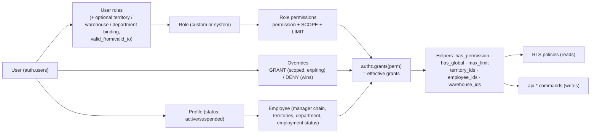

# Authorization Architecture — Honest OS

> Status: **Implemented and Tested** (migrations and pgTAP suites; not Verified on staging) · Phase 1 deliverable #4 · Last updated: 2026-10-30

Authorization is enforced **in the database**: RLS for reads, and permission checks inside `api.*` commands for writes. The UI only hides what the user cannot use; hiding something is never what protects it.

---

## 1. Model

| Concept | Meaning |
|---------|---------|
| **Permission** | `module.resource.action`, e.g. `sales.order.approve`. A catalogue row declares allowed scopes, whether a limit applies and whether it is sensitive. New permissions arrive with migrations; owners grant them, they never activate on their own. |
| **Role** | A named bundle of `(permission, scope, limit)`. Owners/admins create custom roles. Seeded system roles can be edited but not deleted. **Organisational job titles grant nothing.** |
| **Scope** (ABAC) | Which records the permission covers: `own` (records where I am the employee/owner), `team` (me + everyone below me in the manager chain), `territory` (customers/records in my territories, including sub-territories; or a territory bound on the grant), `department`, `warehouse` (bound warehouse), `all`. |
| **Limit** | A numeric ceiling interpreted per permission: `sales.discount.apply` = max manual discount %; `wf.approval.decide.order_value` = max EGP approvable; `inventory.adjustment.post` = max units without approval; `finance.payment.allocate` = max EGP per allocation. **NULL = unlimited.** The highest limit across grants wins; any unlimited grant makes the result unlimited. |
| **Override** | A per-user GRANT (scoped, with expiry, reason required) or DENY. **DENY beats every grant**, including grants from roles. |
| **Owner role** | Exactly one role flagged `is_owner_role`. It has **implicit `all` scope on every permission**, including ones added in the future. It cannot be deleted or deactivated, and at least one active owner must exist at all times (DB-enforced). |
| **Status gates** | A suspended or disabled profile, or an employee whose employment status is `suspended`/`terminated`, has **no** effective grants. This is checked on every call, so suspension takes effect immediately without waiting for token expiry. |

## 2. Permission levels → mechanism

| Requested level | How it is expressed |
|-----------------|---------------------|
| 1. Module access | `<module>.module.access` (e.g. `inventory.module.access`). Navigation and route guards read it, and every page's data is also RLS-protected. |
| 2. Page access | `<module>.page.<name>` for pages that aggregate sensitive data (e.g. `finance.page.aging`, `exec.page.overview`). |
| 3–6. Read / create / edit / delete | `<module>.<resource>.read|create|update|delete` with scope. Hard delete of transactional data does not exist; "delete" means archive/cancel through a command. |
| 7. Export | Every CSV export kind has its own `<module>.<resource>.export` permission, sensitive and MFA-gated, required **together with** the list's read permission (owner decision 2026-10-31, `20261104001100`): orders and order lines `sales.order.export`, customers `crm.customer.export`, invoices `finance.invoice.export`, payments `finance.payment.export`, aging `finance.aging.export` (with `finance.page.aging` or `finance.ledger.read`), visits `field.visit.export`, stock `inventory.stock.export`, team day summary `field.tracking.export`. Every export is gated and audited in the database by `api.log_export`: whitelisted kind, the kind's permissions through `authz.require` (so MFA step-up applies), at most 20 exports per user per 10 minutes. It writes `security_events.export` with kind, filters (free-text search redacted) and request id; `api.log_export_result` then writes `security_events.export_result` with the final row count, truncation and failure. The route fails closed. A `data.export` approval workflow for large exports is not built. |
| 8. Approval | `wf.approval.decide.<workflow>` with a limit (e.g. max EGP). Workflow stages name the permission an approver needs. |
| 9. Field-level visibility | Table split for secrets (e.g. `catalog.cost.read` for `product_costs`). Column masking in `api` views for moderately sensitive fields (e.g. `crm.customer.balance.read`, `core.employee.phone.read`). |
| 10. Record-level visibility | Scope on the read permission + RLS policies. |
| 11. Administrative | `admin.user.*`, `admin.role.*`, `admin.workflow.manage`, `admin.settings.manage`, `admin.integration.manage`, `audit.log.read`, `audit.security.read`. |

## 3. Initial permission catalogue (seeded in Phase 2; extended per module)

| Module | Permissions (scope-able unless noted) |
|--------|----------------------------------------|
| core / admin | `admin.user.read`, `admin.user.create`, `admin.user.suspend`, `admin.role.read`, `admin.role.manage`, `admin.role.assign`, `admin.override.manage`, `admin.workflow.manage`, `admin.settings.manage`, `admin.integration.manage`, `core.employee.read`, `core.employee.manage`, `core.territory.manage`, `audit.log.read`, `audit.security.read` |
| crm | `crm.customer.read`, `crm.customer.create`, `crm.customer.update`, `crm.customer.archive`, `crm.customer.reassign`, `crm.customer.export`, `crm.customer.balance.read`, `crm.customer.location.verify`, `crm.opportunity.read`, `crm.opportunity.manage`, `crm.activity.create` |
| field | `field.visit.create`, `field.visit.read`, `field.visit.exception.request`, `field.location.read` |
| work | `work.task.read`, `work.task.manage` |
| catalog | `catalog.product.read`, `catalog.product.manage`, `catalog.price.read`, `catalog.price.manage`, `catalog.cost.read`, `catalog.cost.manage` |
| inventory | `inventory.module.access`, `inventory.stock.read`, `inventory.movement.read`, `inventory.receipt.post`, `inventory.transfer.create`, `inventory.transfer.receive`, `inventory.adjustment.post` (limit = units), `inventory.writeoff.post`, `inventory.quarantine.release` (sensitive; D-13) |
| sales | `sales.order.read`, `sales.order.create`, `sales.order.submit`, `sales.order.cancel`, `sales.order.fulfil`, `sales.discount.apply` (limit = %), `sales.return.create`, `sales.order.export` |
| finance | `finance.invoice.read`, `finance.invoice.issue`, `finance.credit_note.issue`, `finance.payment.read`, `finance.payment.record`, `finance.payment.confirm`, `finance.payment.allocate` (limit = EGP), `finance.payment.reverse`, `finance.ledger.read`, `finance.collection.manage`, `finance.credit_limit.change`, `finance.page.aging` |
| perf | `perf.kpi.read`, `perf.kpi.manage`, `perf.target.manage`, `perf.commission.read`, `perf.commission_plan.read`, `perf.commission_plan.manage`, `perf.commission.calculate`, `perf.commission.adjust` |
| wf | `wf.approval.read`, `wf.approval.decide.<workflow>` (limit = EGP/%), `wf.delegation.manage` |
| exec / ai | `exec.page.overview`, `ai.assistant.use` |

**Added by the wave-2 modules (2026-10-30).** (MFA) marks `requires_mfa` (§6.7). The approval permissions are seeded as `wf.decide.<workflow>` (e.g. `wf.decide.return`); this document's `wf.approval.decide.<workflow>` is the same thing.

| Module | Permission | Scopes | Sensitive | Default holders | Migration |
|--------|------------|--------|:---------:|-----------------|-----------|
| admin | `admin.import.run` (MFA) | all | ✅ | owner only (implicit) | `20261103000100` |
| audit | `audit.row_image.read` | all | ✅ | owner only (implicit); only an owner can delegate it | `20261103001100` |
| audit | `audit.row_image.unmask` (MFA) | all | ✅ | owner only (implicit) | `20261103001100` |
| field | `field.visit.plan` | own, team, territory, all | — | rep own; area manager team; sales director team | `20261103000900` |
| sales | `sales.return.request` | own, team, territory, all | — | rep own; area manager team; sales director all | `20261103000200` |
| sales | `sales.return.receive` | warehouse, all | — | inventory manager all | `20261103000200` |
| sales | `sales.return.credit` (MFA) | territory, all | ✅ | finance officer all | `20261103000200` |
| wf | `wf.decide.write_off` (MFA, limit = EGP) | any (default set) | ✅ | finance officer all, no limit | `20261103000500` |

Existing codes newly flagged (MFA): `admin.role.assign`, `admin.role.manage`, `admin.override.manage`, `admin.user.suspend`, `admin.settings.manage`, `admin.workflow.manage`, `catalog.price.manage`, `crm.customer.export`, `finance.credit_limit.change`, `finance.payment.reverse`, `inventory.quarantine.release`, `perf.commission.calculate`, `sales.order.export`. `sales.return.create` stays because the order state machine names it; the returns commands use the three `sales.return.*` codes above. New grants of an existing code: `wf.delegation.manage` to the sales director (team), area manager, inventory manager and finance officer (own).

**Per-kind export permissions (`20261104001100`, 2026-10-31).** All (MFA) and sensitive, no limit. Each is granted to exactly the roles that held the paired read permission, at the same scope, so nobody gained or lost an export (suite 54 checks every fixture user against the previous rule). Active per-user grant overrides of the read permission were copied the same way.

| Module | Permission | Pairs with | Scopes | Default holders |
|--------|------------|-----------|--------|-----------------|
| finance | `finance.invoice.export` (MFA) | `finance.invoice.read` | default set | sales director A, area manager Te, rep O, finance A, collection officer A |
| finance | `finance.payment.export` (MFA) | `finance.payment.read` | default set | sales director A, area manager T, rep O, finance A, collection officer O |
| finance | `finance.aging.export` (MFA) | `finance.page.aging` or `finance.ledger.read` | default set | finance A, collection officer A |
| field | `field.visit.export` (MFA) | `field.visit.read` | default set | sales director A, area manager T, rep O |
| inventory | `inventory.stock.export` (MFA) | `inventory.stock.read` | default set | sales director A, area manager A, rep O, inventory manager A, quality manager A |
| field | `field.tracking.export` (MFA) | `field.tracking.read` | own, team, territory, all | sales director T, area manager T |

## 4. Default role matrix (starting point, all editable by the owner)

Legend:
- **O** own, **T** team, **Te** territory, **W** warehouse, **A** all, **—** none.
- Numbers are limits.

| Permission | Owner | Admin | Sales Dir. | Area Mgr | Rep | Inventory Mgr | Finance | Collection Off. | Quality Mgr | Marketing Dir. |
|------------|:-----:|:-----:|:----------:|:--------:|:---:|:-------------:|:-------:|:---------------:|:-----------:|:--------------:|
| crm.customer.read | A | A | A | Te | O | — | A | A | — | A |
| crm.customer.create | A | — | A | Te | O | — | — | — | — | A |
| crm.customer.reassign | A | — | A | Te | — | — | — | — | — | — |
| crm.customer.balance.read | A | — | A | Te | O | — | A | A | — | — |
| field.visit.create | A | — | O | O | O | — | — | O | — | — |
| field.visit.read | A | — | A | T | O | — | — | — | — | — |
| field.location.read | A | — | A | T | — | — | — | — | — | — |
| catalog.price.read | A | A | A | A | A | A | A | A | A | A |
| catalog.cost.read | A | — | — | — | — | A | A | — | — | — |
| catalog.price.manage | A | — | A (approval) | — | — | — | — | — | — | — |
| sales.order.submit | A | — | A | T | O | — | — | — | — | — |
| sales.discount.apply | A (∞) | — | A 20% | T 10% | O 3% | — | — | — | — | — |
| wf.approval.decide.sales.order.discount | A (∞) | — | A 20% | T 10% | — | — | — | — | — | — |
| inventory.stock.read | A | — | A | A | A (available qty only, via view) | A | A | — | A | — |
| inventory.adjustment.post | A (∞) | — | — | — | — | W 5 units | — | — | — | — |
| inventory.quarantine.release | A | — | — | — | — | A | — | — | — | — |
| finance.invoice.issue | A | — | — | — | — | — | A | — | — | — |
| finance.payment.record | A | — | — | T | O | — | A | O | — | — |
| finance.payment.confirm | A | — | — | — | — | — | A | — | — | — |
| finance.payment.allocate | A (∞) | — | — | — | — | — | A (∞) | — | — | — |
| perf.kpi.read | A | — | A | T | O | — | — | — | — | — |
| perf.commission.read | A | — | A | T | O | — | A | — | — | — |
| perf.commission_plan.manage | A | — | — | — | — | — | — | — | — | — |
| admin.role.manage / assign | A | A* | — | — | — | — | — | — | — | — |
| audit.log.read / security | A | A | — | — | — | — | — | — | — | — |
| exec.page.overview | A | — | A | — | — | — | A | — | — | A |
| field.visit.plan | A | — | T | T | O | — | — | — | — | — |
| sales.return.request | A | — | A | T | O | — | — | — | — | — |
| sales.return.receive | A | — | — | — | — | A | — | — | — | — |
| sales.return.credit | A | — | — | — | — | — | A | — | — | — |
| wf.decide.write_off | A (∞) | — | — | — | — | — | A (∞) | — | — | — |
| wf.delegation.manage | A | — | T | O | — | O | O | — | — | — |
| perf.commission.calculate | A | — | — | — | — | — | A | — | — | — |
| admin.import.run | A | — | — | — | — | — | — | — | — | — |
| audit.row_image.read / unmask | A | — | — | — | — | — | — | — | — | — |
| crm.customer.export (MFA) | A | — | A | — | — | — | — | — | — | A |
| sales.order.export (MFA) | A | — | A | — | — | — | — | — | — | — |
| finance.invoice.export (MFA) | A | — | A | Te | O | — | A | A | — | — |
| finance.payment.export (MFA) | A | — | A | T | O | — | A | O | — | — |
| finance.aging.export (MFA) | A | — | — | — | — | — | A | A | — | — |
| field.visit.export (MFA) | A | — | A | T | O | — | — | — | — | — |
| inventory.stock.export (MFA) | A | — | A | A | O | A | — | — | A | — |
| field.tracking.export (MFA) | A | — | T | T | — | — | — | — | — | — |

The export rows are the seeded grants (suite 54 pins them); each mirrors the read permission the kind needs. The read rows above are the brief's starting point and differ in places from the seeded grants (for example `inventory.stock.read`).

\* Admin can assign only roles whose every permission the admin holds at an equal or wider scope (anti-escalation). Admin cannot grant the owner role, cannot edit their own roles, and holds no finance or commission permissions by default, so an IT admin cannot quietly change money.

The rep restrictions requested in the brief map as follows:

| Rep **may not**… | Blocked by |
|------------------|-----------|
| View other reps' private data | `own` scope on CRM, visits, orders, KPIs and commissions (RLS) |
| Access purchase costs | No `catalog.cost.read`; costs live in a separate table (tested) |
| Change commission rates | No `perf.commission_plan.manage` |
| Approve unauthorised discounts | `sales.discount.apply` limit 3% and no `wf.approval.decide.*`. Higher discounts go to approval automatically (tested). |
| Modify inventory balances | No write grant on balances; no `inventory.adjustment.post` (tested) |
| Access company-wide financial reports | No `finance.page.aging`, `exec.page.overview`, or `all` scope on finance permissions |

## 5. Enforcement points

| Layer | Check | Example |
|-------|-------|---------|
| Postgres RLS | Row visibility for every `SELECT` by any client | `customers_select` policy |
| `api.*` commands | `authz.require(perm)` + record scope + limits + state machine | `api.submit_order` (discount limit), `api.visit_check_in` (customer in scope), `api.post_inventory_adjustment` (warehouse scope + unit limit) |
| Next.js server | Session present, input schema, rate limits; calls with the user's JWT | Server actions |
| Next.js UI | Hide or disable controls by `useCan(perm)` (UX only) | Hide "Approve" button |
| Integration layer | Service identity with only the commands it needs (no blanket service role use in handlers beyond the ingestion step) | Paymob webhook → `api.ingest_paymob_event` |
| AI layer | Tools run with the user's JWT, so answers are RLS-filtered | Phase 7 |

## 6. Privilege-escalation prevention

1. **Grant ceiling:** `api.grant_role` (and `api.set_role_permission`, `api.create_override`) require the grantor to hold every permission being granted at an equal or wider scope and limit. Tested: an area manager cannot grant the finance role.
2. **No self-service elevation:** users cannot grant roles or overrides to themselves (tested). Owners are the only exception, and their self-grants are still audited.
3. **Owner role:** only owners can grant it (tested).
4. **No direct table writes:** `authenticated` has no `INSERT/UPDATE/DELETE` on `authz.*` (tested).
5. **Sensitive permissions** (`is_sensitive`) raise a `critical` security event and notify all owners when granted.
6. **Time-bound grants:** overrides should carry `expires_at`. Temporary elevation for holidays uses `wf.delegations`, not permanent roles.
7. **MFA:** permissions flagged `requires_mfa` need an `aal2` session once the owner turns enforcement on. Implemented in `authz.require` / `authz.require_mfa`; see §6.7.

### 6.7 MFA step-up

**Status:** Implemented and Tested (suites 39, 48, 49, 50, 52, 54); enforcement ships **off**. Migrations `20261103000600_mfa_step_up`, `20261104000300_audit4_mfa_gated_set`, `20261104000400_settings_hardening`, `20261104000500_audit4_owner_guards`, `20261104000710_audit4_export_log`, `20261104001100_export_permissions`.

**Rule.** A permission flagged `authz.permissions.requires_mfa` can be exercised only from a session whose JWT claim `aal` is exactly `aal2` (a TOTP factor verified in this session), while `core.system_settings` `security.mfa_enforced` is `true`. Owners are included.

**Mechanism:**
- `authz.require(perm)` checks the permission first, then calls `authz.require_mfa(perm)`. A non-holder therefore always gets `PERMISSION_DENIED`, never `MFA_REQUIRED`.
- `authz.require_mfa` raises `MFA_REQUIRED: …` with SQLSTATE `42501`. `authz.session_aal()` reads the claim the same way `auth.jwt()` does; `authz.mfa_enforced()` reads the switch (only JSON `true` or the string `"true"` turns it on). All three are internal (not executable by `authenticated`).
- `api.my_mfa_status()` returns `{enforced, aal, required_permissions}` for the caller; `api.v_permissions.requires_mfa` exposes the flag.
- Service-role jobs (the commission cron, the escalation job) never pass through `authz.require` and are unaffected.

**Gated set** (23 codes; suites 39 and 48 pin it exactly):

| Area | Codes |
|------|-------|
| Access administration | `admin.role.assign`, `admin.role.manage`, `admin.override.manage`, `admin.user.suspend` |
| Configuration | `admin.settings.manage`, `admin.workflow.manage`, `admin.import.run` |
| Money | `finance.payment.reverse` (reversal, bounce, allocation reversal), `finance.credit_limit.change` (no command yet), `catalog.price.manage`, `wf.decide.write_off`, `sales.return.credit`, `perf.commission.calculate` |
| Stock | `inventory.quarantine.release` |
| Data | `audit.row_image.unmask`; every export permission: `crm.customer.export`, `sales.order.export`, `finance.invoice.export`, `finance.payment.export`, `finance.aging.export`, `field.visit.export`, `inventory.stock.export`, `field.tracking.export` (`20261104001100`) |

**Paths that call `authz.require_mfa` themselves**, because they use a gated permission without `authz.require` on it, or change access without checking the flagged permission:

| Path | When | Step-up of |
|------|------|-----------|
| `inventory.assert_quarantine_release` (`create_transfer`, `receive_transfer`) | stock leaves quarantine for any other warehouse kind; shipping and moves into quarantine are not gated | `inventory.quarantine.release` |
| `audit.read_row_images` (`audit_search`, `audit_record_history`) | only when masked values are revealed; for each gated unmask permission the caller holds | `audit.row_image.unmask` |
| `api.decide_approval` | a stage whose approver permission is gated (today `wf.decide.write_off`), for approve **and** reject | the stage permission |
| `api.set_employment_status` | deactivating, or reactivating from suspended or terminated (active ↔ on leave is not gated) | `admin.user.suspend` |
| `api.update_employee` | the manager or department changes | `admin.role.assign` |
| `api.assign_employee_territory`, `api.end_employee_territory` | the assignment actually changes | `admin.role.assign` |
| `api.move_territory` | a real move | `admin.role.assign` |
| `api.update_setting` | any `security.*` key while enforcement is on | aal2 directly (`MFA_REQUIRED`, 42501) |

`set_territory_coverage` is not gated: it routes new customers only and does not change anyone's scope.

**The switch itself.** `security.mfa_enforced` is owner-only. While it is on, any `security.*` write, including switching it off or re-saving it, needs aal2 (audit 4 A-H1). Switching it on at aal1 is allowed, so the owner can turn it on before enrolling; enrolment on `/account/security` is never gated.

**UI.** Every module's error display shows `MFA_REQUIRED` with a step-up link to `/{locale}/account/security?next=<page>`. After verifying, the security page returns to a safe `next` (off-site paths, the login page, home pages and the security page itself are refused). `useStepUpAction` / `StepUpPrompt` remain for in-place prompts (used by factor removal). A refused export returns JSON (`403 mfa_required`) with no prompt.

**Rollout** (owner; steps in `docs/runbooks/supabase-vercel-setup.md` §2): enable TOTP in Supabase; the owners enrol first, then admin, finance, sales director, inventory manager and catalogue manager; try it on staging; then set the switch on. Rollback is setting it to `false` from an aal2 session. With enforcement on, DB suites that run sensitive steps through `tests.authenticate_as` at aal1 fail by design; use `tests.authenticate_as_aal2`. Since every export is gated, every role that exports (reps, area managers, collection officers and quality managers included) needs a TOTP factor to download a CSV once enforcement is on; their account page lists the export codes under "requires MFA". Pages and reads are not gated.

**Not covered:** no "verified within N minutes" recency check (any aal2 session counts); MFA enrol and removal are logged only in Supabase Auth's audit log, not in `audit.security_events`.

## 7. Owner lock-out safeguards

| Risk | Safeguard | Tested |
|------|-----------|--------|
| Admin revokes the last owner role | Deferred constraint trigger `LAST_OWNER` | ✅ |
| Last owner is suspended | Trigger on `user_profiles.status` | ✅ |
| Owner role deleted or deactivated | `OWNER_ROLE_PROTECTED` trigger | ✅ |
| Owner role loses permissions | Owner = implicit all; `role_permissions` irrelevant for it | by design |
| Owner loses the password / MFA device | **Break-glass procedure:** two owners recommended (D-08). Otherwise, recovery via the Supabase dashboard (project owner account, separate MFA) runs a documented, audited SQL script that re-activates the owner profile. The Supabase org owner account is held by the company owner, not by a developer. | procedure (Phase 2 runbook) |
| Rogue admin creates a parallel "super" role | The grant ceiling prevents it. All role changes are audited, and the weekly owner access review shows them. | ✅ (ceiling) |
| Last owner's employment is ended, or owners deactivate each other | Every last-owner guard counts **effective owners** (below) under one advisory lock. `core.guard_last_owner_employment` (deferred, SECURITY DEFINER) refuses ending the last owner's employment (`LAST_OWNER`). | ✅ suite 50 |
| Owner's profile is re-linked to a suspended employee record, or deleted | Deferred trigger `trg_profiles_last_owner_link` on `core.user_profiles` | ✅ suite 50 |
| Non-owner edits an owner's record | Only an owner can edit an owner's employee record. Non-owners cannot change their own manager, department, status or territories. | ✅ suite 41 |
| Admin widens an owner's auto-approve rule | Auto-approve rules are owner-only end to end (below) | ✅ suite 51 |
| Password-only owner session switches MFA off | `security.*` writes need aal2 while enforcement is on (§6.7) | ✅ suite 49 |

**Effective owner** (`authz.is_effective_owner(user)`, migration `20261104000500`): the profile is active; the employment is active or on leave, or there is no employee record; and the owner role grant is active, not revoked and inside `valid_from`/`valid_to`. It gives the same answer as `my_context().is_owner`. `authz.count_active_owners()` counts these users. Every last-owner guard (role revoke, profile suspend, employment change, profile re-link) takes the advisory lock `authz.lock_owner_set()` before counting, and `api.set_employment_status` takes it first, so two owners deactivating each other at the same time serialise and the second gets `LAST_OWNER` (relies on READ COMMITTED, the PostgREST default). Handing over to an owner who is on leave is allowed.

**Auto-approve rules are owner-only end to end** (`20261104000600`). Only an owner may create a rule with `auto_approve`, or change a rule whose current or new `auto_approve` is true (priority, condition, the flag, switching it off, or its stages through `api.set_workflow_stage`). A non-owner also may not edit a rule checked before an auto-approve rule in a way that could send it more requests: moving it behind the auto rule or changing its condition (even to broaden it) is refused with `OWNER_ONLY` (`wf.rule_change_exposes_auto`). Moving it further forward, or editing rules checked after every auto rule, is allowed.

**Owner-only settings.** `security.*`, `tracking.*`, `finance.payment.*`, `commission.*`, `wf.delegation.*` and `wf.escalation.*` are owner-only by table CHECK on `core.setting_definitions`, as are VAT, visit-GPS retention, `company.timezone`, `company.currency` and the company tax and commercial-register numbers. A non-owner gets `OWNER_ONLY` (42501) before any MFA check.

## 8. Approval-limit configuration

Approval limits are **data**, not code:
- **Limits on permissions** (`role_permissions.limit_value`) decide whether a user can act directly. Example: a 3% discount is applied directly; 5% is not.
- **Workflow rules** (`wf.workflow_rules.condition`) decide who must approve when the user cannot. Example: 3–10% → area manager; > 10% or order total > EGP 250,000 → Sales Director, then Owner.
- Approvers must hold `wf.approval.decide.<workflow>` with a sufficient limit at decision time. An approver cannot approve their own request.

### 8.1 Delegation and escalation authority (`20261103001000`, `20261104000600`)

- **Delegation:** `api.create_delegation` lends the delegator's live authority for a window of at most `wf.delegation.max_days` (90) days. Acting for someone else needs `wf.delegation.manage` covering that employee; nobody can make themselves the delegate (`SELF_GRANT_FORBIDDEN`). A revoked delegation grants nothing, there is no transitive delegation, and a delegate still cannot decide their own request or one about themselves.
- **Escalation targets** (`service.workflow_escalate`: the stage's fallback, then the approver's manager chain, owners last; never the requester or subject) are re-checked **at decision time** by `wf.escalation_target_check`:
  - the target must still be named in an escalation for the request's current stage and be an active user;
  - an active owner always qualifies;
  - **permission and role stages:** the stage's normal eligibility (permission in scope and within its limit, or the role). Escalating these stages widens who is notified, not who may decide. Too low a limit gives `LIMIT_EXCEEDED`;
  - **named-user and requester's-manager stages:** a live link to the stage (its current fallback, or a manager above the named approver, the requester or the fallback) **plus** `wf.approval.read` with a scope covering the request;
  - otherwise `PERMISSION_DENIED`.
- **Stage configuration:** only `wf.decide.*` permissions can approve a stage. A non-owner cannot route a stage to themselves, to a role or permission they hold, or name themselves as fallback (`ESCALATION_BLOCKED`).

### 8.2 Record-level command rules (wave 2)

| Command | Who may | Refusal |
|---------|---------|---------|
| `api.cancel_return` | a `pending_approval` / `requested` return: its requester only (its approval request is cancelled too). An `approved` return that was never received: holders of `wf.decide.return` with the customer in scope, or `sales.return.receive`. A received, credited, rejected or cancelled return: nobody. | `PERMISSION_DENIED`, `INVALID_STATE` |
| `api.request_return` replay | the original creator only, with the customer still in scope | `IDEMPOTENCY_CONFLICT`, `PERMISSION_DENIED` |
| Ordinary credit notes | cannot take quantity an open return holds | `CREDIT_QTY_EXCEEDED` |
| `api.unplan_visit` | a visit the caller planned, or with no recorded planner: anyone with `field.visit.plan` over the visit's employee. A visit someone else planned: that planner, or someone with `field.visit.plan` scope over the planner. Only while `planned`, not checked in, and dated today or later. The planner is notified when someone else removes it. | `PERMISSION_DENIED`, `INVALID_STATE` |
| `api.plan_visits` | `field.visit.plan` over the employee; each customer assigned to that employee **and** readable by the caller (a hidden customer is answered like an unassigned one); at most `planning.daily_visit_cap` visits per employee per day | `NOT_ASSIGNED`, `DAILY_CAP`, `PAST_DATE`, `DUPLICATE` |
| `api.set_visit_frequency` | `crm.customer.update` at team scope or wider, customer in scope (so a rep cannot lower their own target) | `PERMISSION_DENIED` |
| `api.save_order_draft` replay | answered only if the caller still passes the customer and owner scope checks | `PERMISSION_DENIED` |
| `api.request_invoice_write_off` | `finance.collection.manage` with the customer in scope; decided through `finance.write_off` by `wf.decide.write_off` (no self-approval) | `WRITE_OFF_PENDING`, `EXCEEDS_INVOICE_OPEN_AMOUNT` |
| `api.adjust_commission` | `perf.commission.adjust` with scope over the employee; never for yourself; decided through `perf.commission_adjustment` | `SELF_ADJUSTMENT` |
| `api.import_*` | `admin.import.run` at scope all plus the posting permission of the kind (customers `crm.customer.create`, products `catalog.product.manage`, customer prices `catalog.price.manage`, opening stock `inventory.receipt.post`, opening AR none) at scope all | `PERMISSION_DENIED` |

## 9. Admin console (owner/admin capabilities)

| Capability | Screen | Command |
|------------|--------|---------|
| Create/edit custom roles | Roles | `api.create_role`, `api.set_role_permission` |
| Assign/revoke roles (with territory/warehouse binding, validity) | Users → Access | `api.grant_role`, `api.revoke_role` |
| Per-user grant/deny overrides | Users → Exceptions | `api.create_override`, `api.remove_override` |
| Configure approval limits & workflows | Workflows (`/workflow/rules`) | `api.upsert_workflow_rule`, `api.set_workflow_stage` (`admin.workflow.manage`; auto-approve owner-only, §7) |
| Out-of-office delegation | Workflows → Delegations | `api.create_delegation`, `api.revoke_delegation` (`wf.delegation.manage` for someone else) |
| Edit employees, employment status, manager chain | Admin → Employees | `api.update_employee`, `api.set_employment_status` (`core.employee.manage`, scoped; step-up §6.7) |
| Assign territories | Admin → Employees / Territories | `api.assign_employee_territory`, `api.end_employee_territory` |
| Territory tree and coverage | Admin → Territories | `api.create_territory`, `api.rename_territory`, `api.move_territory`, `api.set_territory_active`, `api.set_territory_coverage`, `api.remove_territory_coverage` (`core.territory.manage`; a region, a move to the top level or coverage taken from outside your scope needs scope `all`) |
| System settings | Admin → Settings | `api.update_setting` (`admin.settings.manage`; whitelisted keys only; owner-only families, §7) |
| Data import | Imports | `api.import_*` (`admin.import.run`, owner only by default) |
| Read row-image diffs | Audit (`/audit`) | `api.audit_search`, `api.audit_record_history` (`audit.row_image.read`; reveal needs `audit.row_image.unmask`); every read is logged |
| Restrict modules | Roles (module permissions) | — |
| Review access history | Access review | reads `audit.security_events`, `audit.audit_log` (authz tables) |
| Suspend users | Users | `api.suspend_user` (+ Auth admin sign-out) |
| Review security events | Security | reads `audit.security_events` |
| Effective permission inspector ("why can X see Y?") | Users → Effective access | `api.explain_access(user, perm)` |

## 10. Tests that must stay green (pgTAP in Phase 2)

All scenarios in `docs/database/draft/90_smoke_test.sql` §1 and §5, plus:
- Every permission in the catalogue has at least one RLS or command test.
- A suspended user or terminated employee sees 0 rows on every table.
- DENY override beats a role grant.
- An expired role or override grants nothing.
- Team scope follows a 3-level manager chain and drops a rep moved to another manager.
- Territory scope includes sub-territories and excludes siblings.
- An approver cannot approve their own request or above their limit.
- Matrix test: for each seeded role, a snapshot of allowed commands, diffed in CI so permission drift shows up in review.
