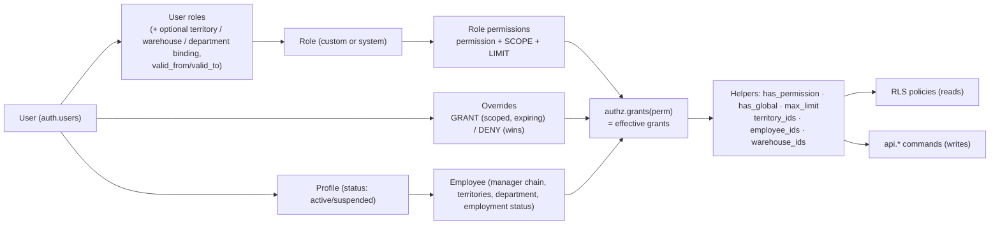

# Authorization Architecture — Honest OS

> Status: **Proposed; core mechanics validated in the draft schema** · Phase 1 deliverable #4 · Last updated: 2026-10-28

Authorization is enforced **in the database**: RLS for reads, and permission checks inside `api.*` commands for writes. The UI only hides what the user cannot use; hiding something is never what protects it.

---

## 1. Model

| Concept | Meaning |
|---------|---------|
| **Permission** | `module.resource.action`, e.g. `sales.order.approve`. A catalogue row declares allowed scopes, whether a limit applies and whether it is sensitive. New permissions arrive with migrations; owners grant them, they never activate on their own. |
| **Role** | A named bundle of `(permission, scope, limit)`. Owners/admins create custom roles. Seeded system roles can be edited but not deleted. **Organisational job titles grant nothing.** |
| **Scope** (ABAC) | Which records the permission covers: `own` (records where I am the employee/owner), `team` (me + everyone below me in the manager chain), `territory` (customers/records in my territories, including sub-territories; or a territory bound on the grant), `department`, `warehouse` (bound warehouse), `all`. |
| **Limit** | A numeric ceiling interpreted per permission: `sales.discount.apply` = max manual discount %; `wf.approval.decide.order_value` = max EGP approvable; `inventory.adjustment.post` = max units without approval; `finance.payment.allocate` = max EGP per allocation. **NULL = unlimited.** The highest limit across grants wins; any unlimited grant makes the result unlimited. |
| **Override** | A per-user GRANT (scoped, with expiry, reason required) or DENY. **DENY beats every grant**, including grants from roles. |
| **Owner role** | Exactly one role flagged `is_owner_role`. It has **implicit `all` scope on every permission**, including ones added in the future. It cannot be deleted or deactivated, and at least one active owner must exist at all times (DB-enforced). |
| **Status gates** | A suspended or disabled profile, or an employee whose employment status is `suspended`/`terminated`, has **no** effective grants. This is checked on every call, so suspension takes effect immediately without waiting for token expiry. |

## 2. Permission levels → mechanism

| Requested level | How it is expressed |
|-----------------|---------------------|
| 1. Module access | `<module>.module.access` (e.g. `inventory.module.access`). Navigation and route guards read it, and every page's data is also RLS-protected. |
| 2. Page access | `<module>.page.<name>` for pages that aggregate sensitive data (e.g. `finance.page.aging`, `exec.page.overview`). |
| 3–6. Read / create / edit / delete | `<module>.<resource>.read|create|update|delete` with scope. Hard delete of transactional data does not exist; "delete" means archive/cancel through a command. |
| 7. Export | `<module>.<resource>.export`. Every export is audited (`security_events.export`) with row count and filters. Large or sensitive exports go through the `data.export` workflow. |
| 8. Approval | `wf.approval.decide.<workflow>` with a limit (e.g. max EGP). Workflow stages name the permission an approver needs. |
| 9. Field-level visibility | Table split for secrets (e.g. `catalog.cost.read` for `product_costs`). Column masking in `api` views for moderately sensitive fields (e.g. `crm.customer.balance.read`, `core.employee.phone.read`). |
| 10. Record-level visibility | Scope on the read permission + RLS policies. |
| 11. Administrative | `admin.user.*`, `admin.role.*`, `admin.workflow.manage`, `admin.settings.manage`, `admin.integration.manage`, `audit.log.read`, `audit.security.read`. |

## 3. Initial permission catalogue (seeded in Phase 2; extended per module)

| Module | Permissions (scope-able unless noted) |
|--------|----------------------------------------|
| core / admin | `admin.user.read`, `admin.user.create`, `admin.user.suspend`, `admin.role.read`, `admin.role.manage`, `admin.role.assign`, `admin.override.manage`, `admin.workflow.manage`, `admin.settings.manage`, `admin.integration.manage`, `core.employee.read`, `core.employee.manage`, `core.territory.manage`, `audit.log.read`, `audit.security.read` |
| crm | `crm.customer.read`, `crm.customer.create`, `crm.customer.update`, `crm.customer.archive`, `crm.customer.reassign`, `crm.customer.export`, `crm.customer.balance.read`, `crm.customer.location.verify`, `crm.opportunity.read`, `crm.opportunity.manage`, `crm.activity.create` |
| field | `field.visit.create`, `field.visit.read`, `field.visit.exception.request`, `field.location.read` |
| work | `work.task.read`, `work.task.manage` |
| catalog | `catalog.product.read`, `catalog.product.manage`, `catalog.price.read`, `catalog.price.manage`, `catalog.cost.read`, `catalog.cost.manage` |
| inventory | `inventory.module.access`, `inventory.stock.read`, `inventory.movement.read`, `inventory.receipt.post`, `inventory.transfer.create`, `inventory.transfer.receive`, `inventory.adjustment.post` (limit = units), `inventory.writeoff.post`, `inventory.quarantine.release` (sensitive; D-13) |
| sales | `sales.order.read`, `sales.order.create`, `sales.order.submit`, `sales.order.cancel`, `sales.order.fulfil`, `sales.discount.apply` (limit = %), `sales.return.create`, `sales.order.export` |
| finance | `finance.invoice.read`, `finance.invoice.issue`, `finance.credit_note.issue`, `finance.payment.read`, `finance.payment.record`, `finance.payment.confirm`, `finance.payment.allocate` (limit = EGP), `finance.payment.reverse`, `finance.ledger.read`, `finance.collection.manage`, `finance.credit_limit.change`, `finance.page.aging` |
| perf | `perf.kpi.read`, `perf.kpi.manage`, `perf.target.manage`, `perf.commission.read`, `perf.commission_plan.read`, `perf.commission_plan.manage`, `perf.commission.calculate`, `perf.commission.adjust` |
| wf | `wf.approval.read`, `wf.approval.decide.<workflow>` (limit = EGP/%), `wf.delegation.manage` |
| exec / ai | `exec.page.overview`, `ai.assistant.use` |

## 4. Default role matrix (starting point, all editable by the owner)

Legend:
- **O** own, **T** team, **Te** territory, **W** warehouse, **A** all, **—** none.
- Numbers are limits.

| Permission | Owner | Admin | Sales Dir. | Area Mgr | Rep | Inventory Mgr | Finance | Collection Off. | Quality Mgr | Marketing Dir. |
|------------|:-----:|:-----:|:----------:|:--------:|:---:|:-------------:|:-------:|:---------------:|:-----------:|:--------------:|
| crm.customer.read | A | A | A | Te | O | — | A | A | — | A |
| crm.customer.create | A | — | A | Te | O | — | — | — | — | A |
| crm.customer.reassign | A | — | A | Te | — | — | — | — | — | — |
| crm.customer.balance.read | A | — | A | Te | O | — | A | A | — | — |
| field.visit.create | A | — | O | O | O | — | — | O | — | — |
| field.visit.read | A | — | A | T | O | — | — | — | — | — |
| field.location.read | A | — | A | T | — | — | — | — | — | — |
| catalog.price.read | A | A | A | A | A | A | A | A | A | A |
| catalog.cost.read | A | — | — | — | — | A | A | — | — | — |
| catalog.price.manage | A | — | A (approval) | — | — | — | — | — | — | — |
| sales.order.submit | A | — | A | T | O | — | — | — | — | — |
| sales.discount.apply | A (∞) | — | A 20% | T 10% | O 3% | — | — | — | — | — |
| wf.approval.decide.sales.order.discount | A (∞) | — | A 20% | T 10% | — | — | — | — | — | — |
| inventory.stock.read | A | — | A | A | A (available qty only, via view) | A | A | — | A | — |
| inventory.adjustment.post | A (∞) | — | — | — | — | W 5 units | — | — | — | — |
| inventory.quarantine.release | A | — | — | — | — | A | — | — | — | — |
| finance.invoice.issue | A | — | — | — | — | — | A | — | — | — |
| finance.payment.record | A | — | — | T | O | — | A | O | — | — |
| finance.payment.confirm | A | — | — | — | — | — | A | — | — | — |
| finance.payment.allocate | A (∞) | — | — | — | — | — | A (∞) | — | — | — |
| perf.kpi.read | A | — | A | T | O | — | — | — | — | — |
| perf.commission.read | A | — | A | T | O | — | A | — | — | — |
| perf.commission_plan.manage | A | — | — | — | — | — | — | — | — | — |
| admin.role.manage / assign | A | A* | — | — | — | — | — | — | — | — |
| audit.log.read / security | A | A | — | — | — | — | — | — | — | — |
| exec.page.overview | A | — | A | — | — | — | A | — | — | A |

\* Admin can assign only roles whose every permission the admin holds at an equal or wider scope (anti-escalation). Admin cannot grant the owner role, cannot edit their own roles, and holds no finance or commission permissions by default, so an IT admin cannot quietly change money.

The rep restrictions requested in the brief map as follows:

| Rep **may not**… | Blocked by |
|------------------|-----------|
| View other reps' private data | `own` scope on CRM, visits, orders, KPIs and commissions (RLS) |
| Access purchase costs | No `catalog.cost.read`; costs live in a separate table (tested) |
| Change commission rates | No `perf.commission_plan.manage` |
| Approve unauthorised discounts | `sales.discount.apply` limit 3% and no `wf.approval.decide.*`. Higher discounts go to approval automatically (tested). |
| Modify inventory balances | No write grant on balances; no `inventory.adjustment.post` (tested) |
| Access company-wide financial reports | No `finance.page.aging`, `exec.page.overview`, or `all` scope on finance permissions |

## 5. Enforcement points

| Layer | Check | Example |
|-------|-------|---------|
| Postgres RLS | Row visibility for every `SELECT` by any client | `customers_select` policy |
| `api.*` commands | `authz.require(perm)` + record scope + limits + state machine | `api.submit_order` (discount limit), `api.visit_check_in` (customer in scope), `api.post_inventory_adjustment` (warehouse scope + unit limit) |
| Next.js server | Session present, input schema, rate limits; calls with the user's JWT | Server actions |
| Next.js UI | Hide or disable controls by `useCan(perm)` (UX only) | Hide "Approve" button |
| Integration layer | Service identity with only the commands it needs (no blanket service role use in handlers beyond the ingestion step) | Paymob webhook → `api.ingest_paymob_event` |
| AI layer | Tools run with the user's JWT, so answers are RLS-filtered | Phase 7 |

## 6. Privilege-escalation prevention

1. **Grant ceiling:** `api.grant_role` (and `api.set_role_permission`, `api.create_override`) require the grantor to hold every permission being granted at an equal or wider scope and limit. Tested: an area manager cannot grant the finance role.
2. **No self-service elevation:** users cannot grant roles or overrides to themselves (tested). Owners are the only exception, and their self-grants are still audited.
3. **Owner role:** only owners can grant it (tested).
4. **No direct table writes:** `authenticated` has no `INSERT/UPDATE/DELETE` on `authz.*` (tested).
5. **Sensitive permissions** (`is_sensitive`) raise a `critical` security event and notify all owners when granted.
6. **Time-bound grants:** overrides should carry `expires_at`. Temporary elevation for holidays uses `wf.delegations`, not permanent roles.
7. **MFA:** sensitive commands (role and permission management, payment reversal, commission approval, exports) require an `aal2` session. Phase 2 implements this as a check in `authz.require_sensitive()`.

## 7. Owner lock-out safeguards

| Risk | Safeguard | Tested |
|------|-----------|--------|
| Admin revokes the last owner role | Deferred constraint trigger `LAST_OWNER` | ✅ |
| Last owner is suspended | Trigger on `user_profiles.status` | ✅ |
| Owner role deleted or deactivated | `OWNER_ROLE_PROTECTED` trigger | ✅ |
| Owner role loses permissions | Owner = implicit all; `role_permissions` irrelevant for it | by design |
| Owner loses the password / MFA device | **Break-glass procedure:** two owners recommended (D-08). Otherwise, recovery via the Supabase dashboard (project owner account, separate MFA) runs a documented, audited SQL script that re-activates the owner profile. The Supabase org owner account is held by the company owner, not by a developer. | procedure (Phase 2 runbook) |
| Rogue admin creates a parallel "super" role | The grant ceiling prevents it. All role changes are audited, and the weekly owner access review shows them. | ✅ (ceiling) |

## 8. Approval-limit configuration

Approval limits are **data**, not code:
- **Limits on permissions** (`role_permissions.limit_value`) decide whether a user can act directly. Example: a 3% discount is applied directly; 5% is not.
- **Workflow rules** (`wf.workflow_rules.condition`) decide who must approve when the user cannot. Example: 3–10% → area manager; > 10% or order total > EGP 250,000 → Sales Director, then Owner.
- Approvers must hold `wf.approval.decide.<workflow>` with a sufficient limit at decision time. An approver cannot approve their own request.

## 9. Admin console (owner/admin capabilities)

| Capability | Screen | Command |
|------------|--------|---------|
| Create/edit custom roles | Roles | `api.create_role`, `api.set_role_permission` |
| Assign/revoke roles (with territory/warehouse binding, validity) | Users → Access | `api.grant_role`, `api.revoke_role` |
| Per-user grant/deny overrides | Users → Exceptions | `api.create_override`, `api.remove_override` |
| Configure approval limits & workflows | Workflows | `api.upsert_workflow_rule` |
| Assign territories | Territories | `api.assign_employee_territory` |
| Restrict modules | Roles (module permissions) | — |
| Review access history | Access review | reads `audit.security_events`, `audit.audit_log` (authz tables) |
| Suspend users | Users | `api.suspend_user` (+ Auth admin sign-out) |
| Review security events | Security | reads `audit.security_events` |
| Effective permission inspector ("why can X see Y?") | Users → Effective access | `api.explain_access(user, perm)` |

## 10. Tests that must stay green (pgTAP in Phase 2)

All scenarios in `docs/database/draft/90_smoke_test.sql` §1 and §5, plus:
- Every permission in the catalogue has at least one RLS or command test.
- A suspended user or terminated employee sees 0 rows on every table.
- DENY override beats a role grant.
- An expired role or override grants nothing.
- Team scope follows a 3-level manager chain and drops a rep moved to another manager.
- Territory scope includes sub-territories and excludes siblings.
- An approver cannot approve their own request or above their limit.
- Matrix test: for each seeded role, a snapshot of allowed commands, diffed in CI so permission drift shows up in review.
