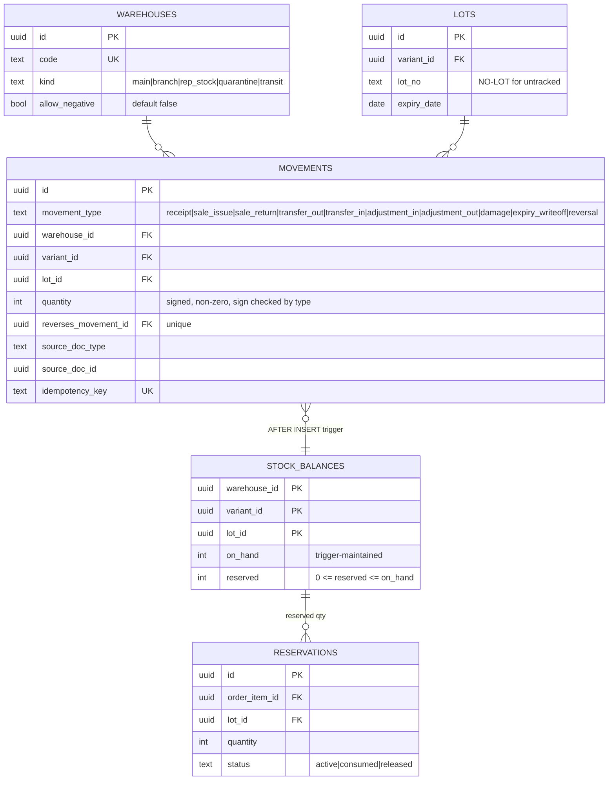
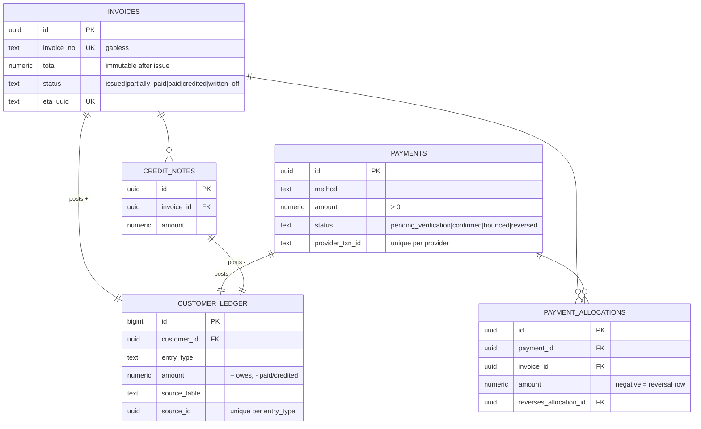

# Database Architecture — Honest OS

> Status: **Migrations implemented and tested locally (PostgreSQL 16); not yet applied to a Supabase project** · Last updated: 2026-10-28
>
> **Source of truth:** [`supabase/migrations/`](../supabase/migrations/), applied in filename order.
> **Tests:** [`supabase/tests/database/`](../supabase/tests/database/), in pgTAP syntax. Run with `pnpm test:db` (local) or `supabase test db` (real pgTAP).
> The Phase 1 draft in `docs/database/draft/` is kept as history only and is no longer maintained.

| Migration | Contents |
|-----------|----------|
| `…000100_extensions_schemas_helpers` | `extensions` schema (pg_trgm, citext), domain schemas, shared helpers (`set_updated_at`, `forbid_mutation`, `distance_m`, `phone_e164`, `money`) |
| `…000200_core` | governorates, departments, offices, territories (+coverage), employees, employee_territories, user_profiles, system_settings, gapless document numbering |
| `…000300_catalog` | brands, categories, products, variants, product_costs (restricted), price lists |
| `…000400_inventory` | warehouses, lots, serials, **movements ledger** + balance trigger, transfers, goods receipts |
| `…000500_authz` | permissions, roles, role_permissions, user_roles, overrides, authz helper functions, owner safeguards |
| `…000600_crm_work_field` | customers, contacts, assignments, opportunities, activities, customer price lists, tasks, visits, location events |
| `…000700_sales` | discount rules, orders, items, status history, transitions, reservations, fulfillments, returns |
| `…000800_finance` | invoices (immutable), credit notes, payments, allocations, AR ledger, balance views, collection tasks |
| `…000900_perf` | KPI definitions/targets/results, commission plans/rules/periods/entries/adjustments |
| `…001000_workflow` | workflow definitions/rules/stages, approval requests/steps, delegations |
| `…001100_audit_notify_integration` | audit log + security events (append-only), audit triggers, notifications, outbox, inbound webhooks, external refs |
| `…001200_commands` | `api.submit_order`, `api.visit_check_in`, `api.post_inventory_adjustment`, `api.grant_role`, price resolution |
| `…001300_rls_grants` | RLS on every table, read grants, policies |
| `…001400_platform_admin` | `api.my_context`, employees/users, suspension, roles/permissions with grant ceiling, notifications, owner bootstrap, admin read views, audit readers |
| `…001500_reference_data` | governorates, regions, specialties, brands, categories, permission catalogue, system roles + grants, settings, order state machine, workflows, KPI catalogue, commission plan draft |

**Local test harness.** This build environment has no Docker and cannot install pgTAP, so `scripts/db-test.sh` runs the migrations on plain PostgreSQL 16 with two test-only files:
- `scripts/db/local_supabase_stub.sql` provides the Supabase roles, `auth.users` and `auth.uid()`.
- `scripts/db/local_pgtap_shim.sql` provides the pgTAP functions the tests use.

The same test files run unchanged under real pgTAP on Supabase. Test helpers and fixtures live in `supabase/seed.sql`, which runs locally and in CI and never in production.

---

## 1. Design conventions

| Rule | Detail | Why |
|------|--------|-----|
| One schema per module | `core`, `authz`, `catalog`, `inventory`, `crm`, `field`, `work`, `sales`, `finance`, `perf`, `wf`, `audit`, `notify`, `integration`; plus `api` (the only schema PostgREST exposes) | Enforced module boundaries; small exposed surface |
| Primary keys | `uuid` (`gen_random_uuid()`). Client-generated allowed for offline commands (visits, orders, payments). Ledgers that are never referenced from clients use `bigint identity`. | Offline idempotency; no guessable ids |
| Human-readable numbers | `SO-2026-000123`, `INV-…`, `CN-…`, `PAY-…` from `core.next_document_no()`: gapless per doc type per year (row lock) | Legal/audit friendliness for invoices |
| Money | `numeric(14,2)` via domain `core.money`; `currency char(3)` default `EGP` on documents | Exact arithmetic; future multi-currency |
| Quantities | `integer` base units (unit, box defined by variant `uom`) | No fractional stock errors |
| Status fields | `text` + `CHECK (...)` | Evolvable by migration without enum lock-in |
| Time | `timestamptz` everywhere (UTC); display in `Africa/Cairo` | DST-safe (Egypt reinstated DST in 2023) |
| Phone | Domain `core.phone_e164`: `+20` + mobile `1[0125]xxxxxxxx` or landline | Validated at the DB, not only the UI |
| Ledgers | `inventory.movements`, `finance.customer_ledger`, `finance.payment_allocations`, `finance.credit_notes`, `finance.invoice_items`, `wf.approval_steps`, `sales.order_status_history`, `audit.*` are **append-only** (trigger `core.forbid_mutation`) | Corrections are visible reversals, never silent edits |
| Derived data | Balances, open amounts, KPI results are derived (trigger-maintained or views/snapshots) | One source of truth per fact |
| Soft delete | Master data uses `archived_at` / `status`; transactional data is never deleted | History preserved, FK integrity |
| Optimistic concurrency | `version int` on records edited from mobile (customers, orders) | Offline conflict detection |
| Functions | `set search_path = ''`, fully qualified names; `SECURITY DEFINER` only for `api.*` commands and `authz.*` helpers | Prevents search-path hijacking |

## 2. Entity relationship diagram

### 2.1 Whole-system relationships (key entities)

```mermaid
erDiagram
  AUTH_USERS ||--o| USER_PROFILES : has
  USER_PROFILES |o--o| EMPLOYEES : "is"
  EMPLOYEES }o--o| EMPLOYEES : "reports to"
  EMPLOYEES ||--o{ EMPLOYEE_TERRITORIES : "assigned"
  TERRITORIES ||--o{ EMPLOYEE_TERRITORIES : ""
  TERRITORIES }o--o| TERRITORIES : "parent"
  DEPARTMENTS ||--o{ EMPLOYEES : ""

  AUTH_USERS ||--o{ USER_ROLES : "granted"
  ROLES ||--o{ USER_ROLES : ""
  ROLES ||--o{ ROLE_PERMISSIONS : ""
  PERMISSIONS ||--o{ ROLE_PERMISSIONS : ""
  AUTH_USERS ||--o{ USER_PERMISSION_OVERRIDES : ""

  TERRITORIES ||--o{ CUSTOMERS : "contains"
  CUSTOMERS ||--o{ CUSTOMER_CONTACTS : ""
  CUSTOMERS ||--o{ CUSTOMER_ASSIGNMENTS : ""
  EMPLOYEES ||--o{ CUSTOMER_ASSIGNMENTS : "owns"
  CUSTOMERS ||--o{ OPPORTUNITIES : ""
  CUSTOMERS ||--o{ ACTIVITIES : "timeline"
  CUSTOMERS ||--o{ TASKS : "follow-ups"
  CUSTOMERS ||--o{ VISITS : ""
  EMPLOYEES ||--o{ VISITS : "performs"
  VISITS ||--o{ LOCATION_EVENTS : "GPS fixes"

  BRANDS ||--o{ PRODUCTS : ""
  CATEGORIES ||--o{ PRODUCTS : ""
  PRODUCTS ||--o{ PRODUCT_VARIANTS : "SKUs"
  PRODUCT_VARIANTS ||--o{ PRODUCT_COSTS : "restricted"
  PRICE_LISTS ||--o{ PRICE_LIST_ITEMS : ""
  PRODUCT_VARIANTS ||--o{ PRICE_LIST_ITEMS : ""
  CUSTOMERS ||--o{ CUSTOMER_PRICE_LISTS : ""

  PRODUCT_VARIANTS ||--o{ LOTS : ""
  WAREHOUSES ||--o{ MOVEMENTS : ""
  LOTS ||--o{ MOVEMENTS : "ledger"
  MOVEMENTS ||--|| STOCK_BALANCES : "derives"
  ORDER_ITEMS ||--o{ RESERVATIONS : ""

  CUSTOMERS ||--o{ ORDERS : ""
  EMPLOYEES ||--o{ ORDERS : "rep"
  ORDERS ||--|{ ORDER_ITEMS : ""
  ORDERS ||--o{ ORDER_STATUS_HISTORY : ""
  ORDERS ||--o{ FULFILLMENTS : ""
  ORDERS ||--o{ RETURNS : ""
  ORDERS ||--o{ INVOICES : ""
  INVOICES ||--|{ INVOICE_ITEMS : ""
  INVOICES ||--o{ CREDIT_NOTES : ""
  CUSTOMERS ||--o{ PAYMENTS : ""
  PAYMENTS ||--o{ PAYMENT_ALLOCATIONS : ""
  INVOICES ||--o{ PAYMENT_ALLOCATIONS : ""
  CUSTOMERS ||--o{ CUSTOMER_LEDGER : "AR"
  INVOICES ||--o{ COLLECTION_TASKS : ""

  KPI_DEFINITIONS ||--o{ KPI_TARGETS : ""
  KPI_DEFINITIONS ||--o{ KPI_RESULTS : ""
  COMMISSION_PLANS ||--o{ COMMISSION_PLAN_RULES : ""
  EMPLOYEES ||--o{ EMPLOYEE_COMMISSION_PLANS : ""
  COMMISSION_PERIODS ||--o{ COMMISSION_ENTRIES : ""
  PAYMENT_ALLOCATIONS ||--o{ COMMISSION_ENTRIES : "basis"

  WORKFLOW_DEFINITIONS ||--o{ WORKFLOW_RULES : ""
  WORKFLOW_RULES ||--o{ WORKFLOW_STAGES : ""
  WORKFLOW_DEFINITIONS ||--o{ APPROVAL_REQUESTS : ""
  APPROVAL_REQUESTS ||--o{ APPROVAL_STEPS : ""
```



### 2.2 Inventory ledger detail



### 2.3 Receivables detail



## 3. Table inventory

80 tables + 3 views in the draft. Requested entities → actual design (decisions noted):

| Requested entity | Implemented as | Note |
|------------------|----------------|------|
| users | `auth.users` (Supabase) + `core.user_profiles` | App state separate from the auth provider |
| employees, departments, territories, employee_territories | `core.*` (+ `core.offices`, `core.governorates`, `core.territory_coverage`) | Hierarchical territories, coverage map for auto-assignment |
| roles, permissions, role_permissions, user_permissions | `authz.roles`, `authz.permissions`, `authz.role_permissions` (with `scope`, `limit_value`), `authz.user_roles` (with ABAC bindings), `authz.user_permission_overrides` | See AUTHORIZATION.md |
| customers, leads | `crm.customers` with `lifecycle_stage` | **ADR-012:** one entity; avoids lead→customer copy and cross-table duplicates |
| customer_contacts, customer_assignments, opportunities, customer_activities | `crm.customer_contacts`, `crm.customer_assignments`, `crm.opportunities`, `crm.activities` | One open `primary_rep` per customer (partial unique index) |
| follow_up_tasks | `work.tasks` (kind = follow_up/collection/…) | Shared task engine for CRM, finance, QMS |
| visits, visit_locations | `field.visits`, `field.location_events` | Raw fixes separated: different retention and access |
| sales_orders, sales_order_items, order_status_history | `sales.orders`, `sales.order_items`, `sales.order_status_history`, `sales.order_transitions` | State machine as data |
| price_lists, discount_rules | `catalog.price_lists`, `catalog.price_list_items`, `catalog.customer_price_lists`, `sales.discount_rules` | |
| products, product_variants, brands | `catalog.*` + `catalog.categories`, `catalog.product_costs` | Cost split out for field-level security |
| warehouses, inventory_lots, inventory_movements, inventory_reservations, stock_transfers | `inventory.warehouses`, `inventory.lots`, `inventory.serials`, `inventory.movements`, `inventory.stock_balances`, `inventory.reservations`, `inventory.transfers` (+items), `inventory.goods_receipts` (+items) | |
| invoices, invoice_items, payments, payment_allocations | `finance.*` + `finance.credit_notes` | |
| customer_balances | `finance.customer_ledger` + view `finance.v_customer_balances` | Derived, never stored as editable number |
| collection_tasks | `finance.collection_tasks` | Promise-to-pay fields |
| kpi_definitions, kpi_targets, kpi_results | `perf.*` | Targets per role / employee / territory (exactly one) |
| commission_plans, commission_entries, commission_adjustments | `perf.commission_plans`, `perf.commission_plan_rules`, `perf.employee_commission_plans`, `perf.commission_periods`, `perf.commission_entries`, `perf.commission_adjustments` | |
| approval_workflows, approval_requests, approval_steps | `wf.workflow_definitions`, `wf.workflow_rules`, `wf.workflow_stages`, `wf.approval_requests`, `wf.approval_steps`, `wf.delegations` | |
| audit_logs | `audit.audit_log`, `audit.security_events` | |
| notifications | `notify.notifications`, `notify.channel_preferences` | |
| system_settings | `core.system_settings` (no secrets — CHECK enforced) | |
| integration_events | `integration.outbox`, `integration.inbound_webhooks`, `integration.external_refs` | |

**Not yet modelled (Phase 7):** QMS (`qms.complaints`, `qms.capa`, `qms.recalls` → lot links), Academy (`academy.courses`, `academy.sessions`, `academy.enrollments`, `academy.certificates` → customer links), Documents (`docs.documents`, `docs.versions` → Storage paths, permissioned). Suppliers/purchase orders depend on U-13.

## 4. Key constraints and invariants (all enforced in the DB)

| Invariant | Mechanism | Tested |
|-----------|-----------|--------|
| No stock change without a movement | `stock_balances` has no write grant; only the `inventory.apply_movement` trigger writes it | ✅ |
| No negative stock unless warehouse policy allows | Trigger check against `warehouses.allow_negative` | ✅ |
| `reserved` never exceeds on-hand | `CHECK (reserved <= greatest(on_hand,0))` | partial (constraint present) |
| Movement sign matches type | CHECK constraints | ✅ |
| Ledgers are append-only | `core.forbid_mutation` triggers | ✅ |
| Issued invoice amounts immutable | `finance.guard_invoice_update` trigger | ✅ |
| Totals add up | `CHECK (total = subtotal - discount_total + tax_total)` on orders/invoices/lines | ✅ (via submit) |
| A document posts to the AR ledger once | `unique(source_table, source_id, entry_type)` | constraint present |
| No double commission | `unique(source_type, source_id, invoice_item_id, employee_id)` | constraint present |
| One open primary rep per customer | partial unique index | constraint present |
| No duplicate active mobile number | partial unique index on `phone_primary` | constraint present |
| One pending approval per entity per workflow | partial unique index | constraint present |
| ≥ 1 active owner | deferred constraint triggers on `user_roles`, `user_profiles` | ✅ |
| Owner role cannot be deleted/deactivated | trigger | ✅ |
| KPI target has exactly one assignee type | `CHECK (num_nonnulls(role_id, employee_id, territory_id) = 1)` | constraint present |
| Settings never store secrets | `CHECK (is_secret = false)`; secrets live in Vault/env | constraint present |

## 5. Indexing strategy

- Every FK used in RLS predicates or joins is indexed (`customers.territory_id`, `customer_assignments.employee_id` partial on open, `orders.employee_id`, `visits.employee_id`, …).
- Partial indexes for hot subsets: open invoices by due date, pending/failed outbox, unread notifications, active reservations.
- `pg_trgm` GIN index on `customers.display_name` for duplicate detection and fuzzy search.
- Time-ordered access: `(employee_id, check_in_at desc)`, `(customer_id, occurred_at desc)`.
- **RLS performance rule:** policies wrap helpers in `(select …)` so Postgres evaluates them once per statement (initPlan), not once per row. Array helpers are cast (`::uuid[]`) so they are scalar expressions. Phase 2 adds `EXPLAIN ANALYZE` checks on the 10 heaviest queries with 50k customers / 1M movements of synthetic data.
- **Scaling path:** when `inventory.movements` or `audit.audit_log` pass ~10M rows, partition by month (`created_at`) using declarative partitioning. When authz lookups show up in profiles, add a per-user effective-permission cache table refreshed by triggers on `user_roles`/`role_permissions`.

## 6. RLS strategy

1. **RLS enabled on every table** in domain schemas. A table with no policy returns no rows to `authenticated`/`anon` (deny by default, tested).
2. **Not FORCED (ADR-005).** Tables and `SECURITY DEFINER` functions share one owner role, so commands run without RLS but do their own explicit `authz` checks. FORCE would make definer functions subject to RLS and re-create policy recursion. We found and fixed that recursion in testing (customers ↔ assignments) by moving assignment lookups into `authz.assigned_customer_ids()`.
3. **Reads:** `authenticated` gets `SELECT`, and policies filter by scope:
   - `has_global(perm)` → all rows
   - `territory_id = any(authz.territory_ids(perm))` → territory (incl. descendants)
   - `employee_id = any(authz.employee_ids(perm))` → own/team (recursive manager chain)
   - `warehouse_id = any(authz.warehouse_ids(perm))` → warehouse
   - child tables inherit the parent's visibility with `exists (select 1 from parent …)`
4. **Writes:** no `INSERT/UPDATE/DELETE` grants to `authenticated` on domain tables, except narrow self-service (`notifications.read_at`). All writes go through `api.*` commands.
5. **Field-level visibility:**
   - (a) **Table split** for highly sensitive fields (`catalog.product_costs`, future `core.employee_compensation`).
   - (b) **Column masking** in `api` views for moderately sensitive fields: `case when authz.has_permission('crm.customer.balance.read') then balance end`.
   - (c) Column-level `GRANT` for exceptional cases.
6. **Exposure:** PostgREST `db-schemas = api` only. `api` views are `security_invoker = true`, so they run with the caller's RLS.

## 7. Migration strategy

- Tooling: **Supabase CLI** SQL migrations (`supabase/migrations/YYYYMMDDHHMMSS_name.sql`), reviewed like code. No ORM owns the schema (ADR-009). TS types come from `supabase gen types typescript`.
- Order of initial migrations (Phase 2–4): `0001_extensions_schemas` → `0002_core` → `0003_authz` → `0004_audit_notify_integration` → `0005_catalog` → `0006_inventory` → `0007_crm_field_work` → `0008_sales` → `0009_finance` → `0010_perf` → `0011_wf` → `0012_rls` → `0013_api` → seeds.
- **Expand → migrate → contract** for breaking changes. Destructive steps need owner approval and a verified backup.
- Every migration PR includes pgTAP tests and passes `supabase db reset && supabase test db` in CI.
- **Data migration from spreadsheets:**
  1. Staging tables (`import.*`) hold the raw file, loaded as-is.
  2. Validation SQL produces a rejects report (bad phones, duplicates, missing territory).
  3. Load through the same `api.*` commands (or bulk equivalents) so every rule applies.
  4. Opening stock = `receipt` movements per lot. Opening AR = `opening_balance` ledger entries per customer (or open invoices).
  5. Reconcile totals against the source and get owner sign-off.

## 8. Audit strategy

| Layer | What | Where |
|-------|------|-------|
| Row changes | Generic trigger `audit.log_change()` on 32 business tables: actor (`auth.uid()`), action, old/new JSON, changed fields, request id | `audit.audit_log` (append-only) |
| Security events | Logins (Auth hook/log drain), permission denials, role grants/revokes, suspensions, exports, owner changes | `audit.security_events` (append-only) |
| Business history | Order status history, approval steps, ledgers | Domain tables (append-only) |
| Access history | Supabase Auth audit log (sign-ins), exported nightly into `audit.security_events` | |
| Retention | Audit: 7 years (aligned with the 7-year e-invoice retention cited by sources; **confirm with accountant**). GPS raw fixes: 12 months. Notifications: 12 months. | pg_cron jobs |

Audit rows are readable only with `audit.log.read` (owner/admin). The owner's **Access review** screen shows permission changes and security events.

## 9. How to run the database tests

```bash
# Any PostgreSQL 16 server you can reach as a superuser (no Supabase needed):
PGHOST=localhost PGUSER=postgres PGPASSWORD=postgres pnpm test:db
# → fresh database, stub, shim, all migrations, seed, then every *.test.sql file;
#   exits non-zero on any "not ok", unmet plan, or SQL error.

# On a Supabase stack (real pgTAP):
supabase start && supabase db reset && supabase test db
```

**Rules for writing migrations** (enforced by tests where possible):
- Never edit an applied migration. Add a new one (`create or replace` is fine for functions).
- Every migration that creates `api` functions ends with `revoke execute on all functions in schema api from public; grant execute on all functions in schema api to authenticated;`. Test 08 fails if `anon` can execute any `api` function. Schema-scoped `ALTER DEFAULT PRIVILEGES` cannot revoke PostgreSQL's global PUBLIC execute default; we learned this the hard way.
- Hook and internal functions (`wf.on_decided_*`, retention jobs, `core.bootstrap_owner`) are revoked from `public`.
- New tables get RLS enabled, a select policy and a `grant select` to `authenticated`. Never `insert/update/delete` grants on domain tables.
- **Never grant `authenticated` access to `auth.users`.** Supabase applies no RLS there, so any grant leaks every user's email.

**Open verification items (need a real Supabase project, R-17):**
- RLS behaviour for table-owner `SECURITY DEFINER` functions. Expected: the owner bypasses non-forced RLS.
- `auth.uid()` semantics match the stub.
- pg_cron/pg_net availability on the chosen plan.
- PostgreSQL 17 compatibility (`config.toml` targets 17; local tests run on 16).
