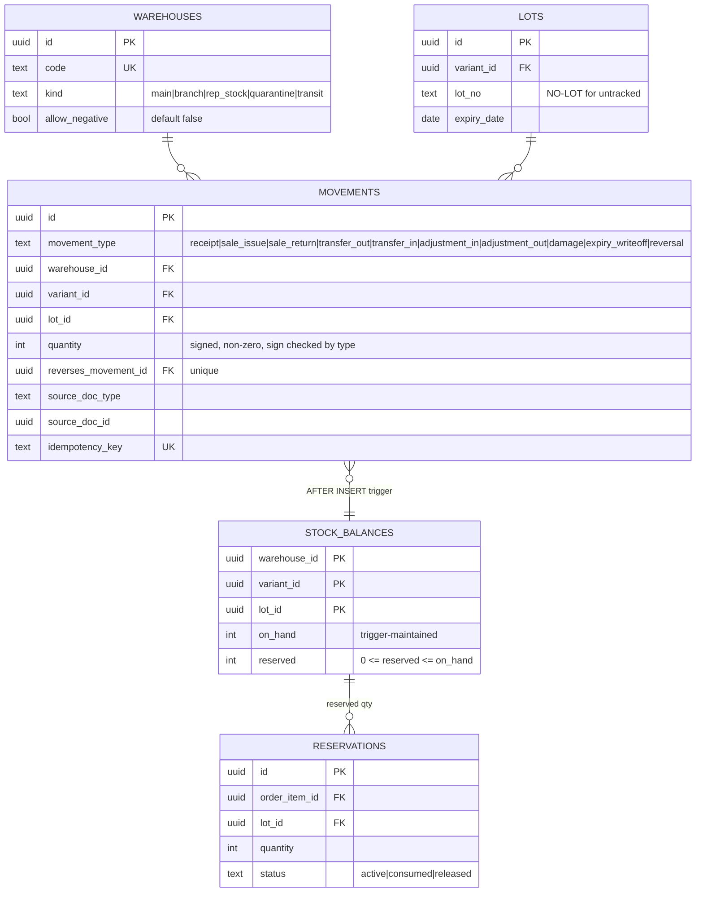
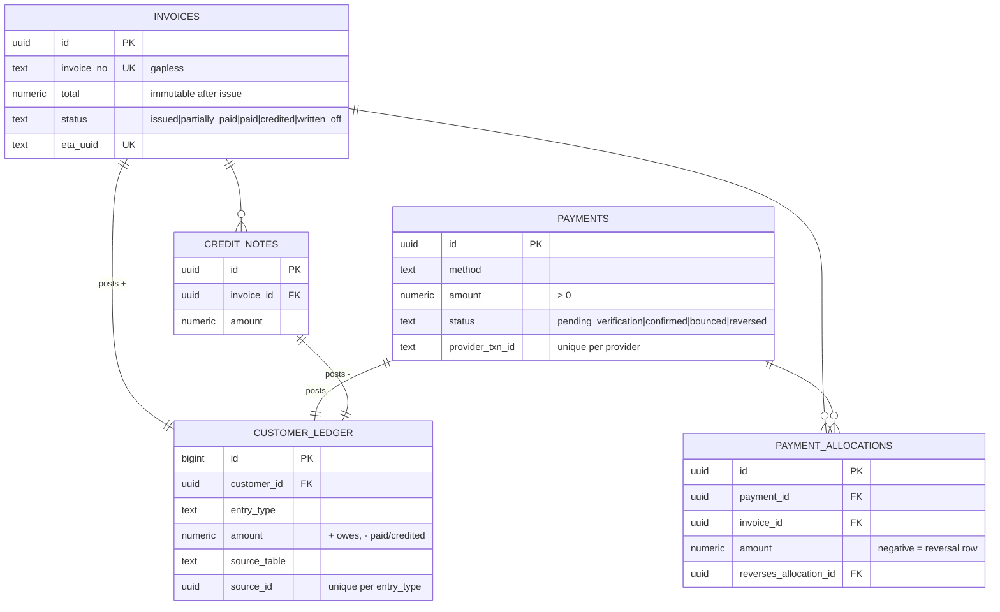

# Database Architecture — Honest OS

> Status: **Migrations implemented and tested locally (PostgreSQL 16); 35 earlier migrations are applied to Supabase staging; the wave-2 and audit-4 migrations are partly applied and being finished** · Last updated: 2026-10-30
>
> **Source of truth:** [`supabase/migrations/`](../supabase/migrations/), applied in filename order.
> **Tests:** [`supabase/tests/database/`](../supabase/tests/database/), in pgTAP syntax. Run with `pnpm test:db` (local) or `supabase test db` (real pgTAP).
> The Phase 1 draft in `docs/database/draft/` is kept as history only and is no longer maintained.

| Migration | Contents |
|-----------|----------|
| `…000100_extensions_schemas_helpers` | `extensions` schema (pg_trgm, citext), domain schemas, shared helpers (`set_updated_at`, `forbid_mutation`, `distance_m`, `phone_e164`, `money`) |
| `…000200_core` | governorates, departments, offices, territories (+coverage), employees, employee_territories, user_profiles, system_settings, gapless document numbering |
| `…000300_catalog` | brands, categories, products, variants, product_costs (restricted), price lists |
| `…000400_inventory` | warehouses, lots, serials, **movements ledger** + balance trigger, transfers, goods receipts |
| `…000500_authz` | permissions, roles, role_permissions, user_roles, overrides, authz helper functions, owner safeguards |
| `…000600_crm_work_field` | customers, contacts, assignments, opportunities, activities, customer price lists, tasks, visits, location events |
| `…000700_sales` | discount rules, orders, items, status history, transitions, reservations, fulfillments, returns |
| `…000800_finance` | invoices (immutable), credit notes, payments, allocations, AR ledger, balance views, collection tasks |
| `…000900_perf` | KPI definitions/targets/results, commission plans/rules/periods/entries/adjustments |
| `…001000_workflow` | workflow definitions/rules/stages, approval requests/steps, delegations |
| `…001100_audit_notify_integration` | audit log + security events (append-only), audit triggers, notifications, outbox, inbound webhooks, external refs |
| `…001200_commands` | `api.submit_order`, `api.visit_check_in`, `api.post_inventory_adjustment`, `api.grant_role`, price resolution |
| `…001300_rls_grants` | RLS on every table, read grants, policies |
| `…001400_platform_admin` | `api.my_context`, employees/users, suspension, roles/permissions with grant ceiling, notifications, owner bootstrap, admin read views, audit readers |
| `…001500_reference_data` | governorates, regions, specialties, brands, categories, permission catalogue, system roles + grants, settings, order state machine, workflows, KPI catalogue, commission plan draft |
| `20261029000100_outbox_dispatch` | `service` schema (service_role only), `integration.routes`, outbox claim/result with lease recovery and backoff, admin retry and health views |
| `20261029000200_crm_field_commands` | customers (create/update/location/reassign), opportunities, tasks, activities, visit check-out and exceptions, approval hooks, GPS retention purge, CRM read views |
| `20261029000300_orders_inventory_workflow` | approval engine (`decide_approval`, rule conditions, stages, limits, scope, delegation), order drafts/approve/reject/reserve (FEFO)/fulfil/cancel, credit check, goods receipts, transfers, adjustment approvals, read views |
| `20261029000900_views_security_invoker` | every view runs with caller rights (fix: plain views leaked balances) |
| `20261029000950_approval_request_context` | approval requests get subject employee + territory/warehouse filled from their entity |
| `20261029001000_audit_fixes` | fixes for the 2026-10-29 audit (#1–#5, #8, #11, #13, #15); suite 17 |
| `20261029001050_audit_fix_functions` | the same audit's function redefinitions (generated by `scripts/db/gen_audit_fix_functions.py`) |
| `20261029001100_rls_initplan` | five policies wrap `auth.uid()` as `(select auth.uid())` (Supabase advisor) |
| `20261030000100_crm_ui_reads` | CRM read surface for the screens (governorates, specialties, assignable employees, duplicates) |
| `20261030000300_orders_ui_views` | `v_sellable_variants`, `v_order_status_history` |
| `20261030000400_inventory_ui_views` | inventory workspace views |
| `20261030000500_approvals_ui` | approvals inbox and request detail reads |
| `20261030000600_catalog_commands` | catalogue administration commands (products, variants, price lists, promotions) |
| `20261030000700_audit_phase3_fixes` | fixes for the Phase 3 audit (price-list visibility, quarantine release D-13, …); suite 25 |
| `20261030000800_create_customer_scope` | `create_customer` names duplicates only inside the caller's scope; suite 26 |
| `20261031000100_finance_ar_commands` | AR core commands: invoices, credit notes, payments, allocation, collection tasks, overdue scan |
| `20261031000110_finance_ar_views` | AR policies and `api` views (statement, aging, collections) |
| `20261031000200_dashboards_kpis` | KPI metric functions, targets, snapshots, dashboard reads |
| `20261031000300_tracking` | work-hours tracking (D-14 phase 1): notice, shifts, location pings, day summaries, purge |
| `20261101000100_audit3_finance_fixes` | third audit, AR and dashboards (per-customer AR lock, back-dating limits, …); suite 31 |
| `20261101000200_audit3_tracking_fixes` | third audit, tracking (point caps, spacing, overlap clamp, retention by capture time); suite 32 |
| `20261102000100_tracking_native_source` | `record_location_pings` accepts `source = 'native'` (Android app); suite 33 |
| `20261103000100_import_schema` | schema `import` (`batches`, `rows`), permission `admin.import.run` |
| `20261103000110_import_commands` | `api.import_create_batch / _validate / _commit / _discard`, import views; suite 34 |
| `20261103000200_returns` | returns: request with approval, receive into quarantine, credit at invoiced prices; three `sales.return.*` permissions; suite 35 |
| `20261103000299_dispatch` | approval-hook branch for `sales.return` (superseded by `…009900`) |
| `20261103000300_orders_offline_drafts` | replay-safe `save_order_draft`, table `sales.order_draft_saves`; suite 36 |
| `20261103000400_commissions` | commission engine, statements, period close, adjustments, cron function; suite 37 |
| `20261103000499_dispatch` | approval-hook branch for `perf.commission_adjustment` (superseded by `…009900`) |
| `20261103000500_finance_write_off_print` | invoice write-off through approval, `finance.invoice_write_offs`, `company.*` settings and print reads; suite 38 |
| `20261103000599_dispatch` | approval-hook branch for `finance.write_off` (superseded by `…009900`) |
| `20261103000600_mfa_step_up` | `authz.permissions.requires_mfa`, `security.mfa_enforced`, `authz.require_mfa` inside `authz.require`, `api.my_mfa_status`; suite 39 |
| `20261103000700_performance_indexes` | covering index for every foreign key, hot-filter indexes, materialized scope CTE in `crm.customer_balances_in_scope`; suite 40 |
| `20261103000800_admin_settings` | `core.setting_definitions` whitelist, `api.update_setting`, `api.v_settings` |
| `20261103000810_admin_employees` | employee edit, employment status, territory assignment, manager-cycle trigger, last-owner employment guard |
| `20261103000820_admin_territories` | territory tree and coverage commands, territory-cycle trigger; suite 41 covers 0800–0820 |
| `20261103000900_planning` | visit planning and coverage: `field.visit.plan`, `field.visit_frequencies`, `field.visit_plan_batches`, `planning.*` settings; suite 42 |
| `20261103001000_workflow_admin` | rules editor, delegation and escalation commands, `wf.approval_escalations`, `service.workflow_escalate`; suite 43 |
| `20261103001100_audit_row_image_reader` | masked, logged row-image reader, `audit.row_image_masks`, `audit.row_image.*` permissions; suite 44 |
| `20261103009800_wave2_integration` | covering indexes for the wave-2 foreign keys, allocation-date index, setting definitions for the other modules' settings |
| `20261103009900_dispatch_consolidated` | one `wf.dispatch_decision_hook` with every hook branch; suite 45 |
| `20261104000100_audit4_returns_ar` | audit 4 M-1, M-3 (returns), M-4: returns on paid invoices as customer credit, `api.cancel_return`, `payment_allocations.credit_note_id`, overdue history; suite 46 |
| `20261104000200_audit4_imports_drafts` | audit 4 M-2, M-3 (orders): per-kind import commit lock, one opening balance per customer, draft-replay scope check; suite 47 |
| `20261104000300_audit4_mfa_gated_set` | audit 4 A-M1, M-5: wider gated set, step-up in quarantine release, row-image reveal and `decide_approval`; suite 48 |
| `20261104000400_settings_hardening` | audit 4 A-H1, A-L3: `security.*` writes need aal2, owner-only workflow limits, text limits, unanchored secret check, logo path rule; suite 49 |
| `20261104000500_audit4_owner_guards` | audit 4 A-M2, A-M3, A-M1: effective-owner predicate, owner-set lock, definer employment guard, profile re-link guard, step-up on employee and territory changes; suite 50 |
| `20261104000600_audit4_workflow_authority` | audit 4 A-M4, A-L1: owner-only auto-approve rules, live escalation authority; suite 51 |
| `20261104000700_audit4_row_image_masks` | audit 4 A-LM2: case-insensitive masks, derived-value keys, `row_image_masks.container_only`; suite 52 |
| `20261104000710_audit4_export_log` | audit 4 A-L4: `api.log_export`, `api.log_export_result`, export permissions gated, `security_events` index; suite 52 |
| `20261104000800_audit4_planning` | audit 4 F2, F5, F6, F9: daily cap, linear generator, read scope, `field.visits.planned_by`, faster coverage; suite 53 |

**Local test harness.** This build environment has no Docker and cannot install pgTAP, so `scripts/db-test.sh` runs the migrations on plain PostgreSQL 16 with two test-only files:
- `scripts/db/local_supabase_stub.sql` provides the Supabase roles, `auth.users` and `auth.uid()`.
- `scripts/db/local_pgtap_shim.sql` provides the pgTAP functions the tests use.

The same test files run unchanged under real pgTAP on Supabase. Test helpers and fixtures live in `supabase/seed.sql`, which runs locally and in CI and never in production.

---

## 1. Design conventions

| Rule | Detail | Why |
|------|--------|-----|
| One schema per module | `core`, `authz`, `catalog`, `inventory`, `crm`, `field`, `work`, `sales`, `finance`, `perf`, `wf`, `audit`, `notify`, `integration`; `import` (data-migration staging, not exposed); plus `api` (exposed to clients) and `service` (exposed, `service_role` only, ADR-024) | Enforced module boundaries; small exposed surface |
| Primary keys | `uuid` (`gen_random_uuid()`). Client-generated allowed for offline commands (visits, orders, payments). Ledgers that are never referenced from clients use `bigint identity`. | Offline idempotency; no guessable ids |
| Human-readable numbers | `SO-2026-000123`, `INV-…`, `CN-…`, `PAY-…` from `core.next_document_no()`: gapless per doc type per year (row lock) | Legal/audit friendliness for invoices |
| Money | `numeric(14,2)` via domain `core.money`; `currency char(3)` default `EGP` on documents | Exact arithmetic; future multi-currency |
| Quantities | `integer` base units (unit, box defined by variant `uom`) | No fractional stock errors |
| Status fields | `text` + `CHECK (...)` | Evolvable by migration without enum lock-in |
| Time | `timestamptz` everywhere (UTC); display in `Africa/Cairo` | DST-safe (Egypt reinstated DST in 2023) |
| Business day | `core.business_date()` = today in `Africa/Cairo`; never `current_date` (UTC on Supabase) in new code | Expiry, price-list and promotion dates must match the day the user sees (audit 2026-10-30, F10) |
| Phone | Domain `core.phone_e164`: `+20` + mobile `1[0125]xxxxxxxx` or landline | Validated at the DB, not only the UI |
| Ledgers | `inventory.movements`, `finance.customer_ledger`, `finance.payment_allocations`, `finance.credit_notes`, `finance.invoice_items`, `wf.approval_steps`, `sales.order_status_history`, `audit.*` are **append-only** (trigger `core.forbid_mutation`) | Corrections are visible reversals, never silent edits |
| Derived data | Balances, open amounts, KPI results are derived (trigger-maintained or views/snapshots) | One source of truth per fact |
| Soft delete | Master data uses `archived_at` / `status`; transactional data is never deleted | History preserved, FK integrity |
| Optimistic concurrency | `version int` on records edited from mobile (customers, orders) | Offline conflict detection |
| Functions | `set search_path = ''`, fully qualified names; `SECURITY DEFINER` only for `api.*` commands and `authz.*` helpers | Prevents search-path hijacking |

## 2. Entity relationship diagram

### 2.1 Whole-system relationships (key entities)

```mermaid
erDiagram
  AUTH_USERS ||--o| USER_PROFILES : has
  USER_PROFILES |o--o| EMPLOYEES : "is"
  EMPLOYEES }o--o| EMPLOYEES : "reports to"
  EMPLOYEES ||--o{ EMPLOYEE_TERRITORIES : "assigned"
  TERRITORIES ||--o{ EMPLOYEE_TERRITORIES : ""
  TERRITORIES }o--o| TERRITORIES : "parent"
  DEPARTMENTS ||--o{ EMPLOYEES : ""

  AUTH_USERS ||--o{ USER_ROLES : "granted"
  ROLES ||--o{ USER_ROLES : ""
  ROLES ||--o{ ROLE_PERMISSIONS : ""
  PERMISSIONS ||--o{ ROLE_PERMISSIONS : ""
  AUTH_USERS ||--o{ USER_PERMISSION_OVERRIDES : ""

  TERRITORIES ||--o{ CUSTOMERS : "contains"
  CUSTOMERS ||--o{ CUSTOMER_CONTACTS : ""
  CUSTOMERS ||--o{ CUSTOMER_ASSIGNMENTS : ""
  EMPLOYEES ||--o{ CUSTOMER_ASSIGNMENTS : "owns"
  CUSTOMERS ||--o{ OPPORTUNITIES : ""
  CUSTOMERS ||--o{ ACTIVITIES : "timeline"
  CUSTOMERS ||--o{ TASKS : "follow-ups"
  CUSTOMERS ||--o{ VISITS : ""
  EMPLOYEES ||--o{ VISITS : "performs"
  VISITS ||--o{ LOCATION_EVENTS : "GPS fixes"

  BRANDS ||--o{ PRODUCTS : ""
  CATEGORIES ||--o{ PRODUCTS : ""
  PRODUCTS ||--o{ PRODUCT_VARIANTS : "SKUs"
  PRODUCT_VARIANTS ||--o{ PRODUCT_COSTS : "restricted"
  PRICE_LISTS ||--o{ PRICE_LIST_ITEMS : ""
  PRODUCT_VARIANTS ||--o{ PRICE_LIST_ITEMS : ""
  CUSTOMERS ||--o{ CUSTOMER_PRICE_LISTS : ""

  PRODUCT_VARIANTS ||--o{ LOTS : ""
  WAREHOUSES ||--o{ MOVEMENTS : ""
  LOTS ||--o{ MOVEMENTS : "ledger"
  MOVEMENTS ||--|| STOCK_BALANCES : "derives"
  ORDER_ITEMS ||--o{ RESERVATIONS : ""

  CUSTOMERS ||--o{ ORDERS : ""
  EMPLOYEES ||--o{ ORDERS : "rep"
  ORDERS ||--|{ ORDER_ITEMS : ""
  ORDERS ||--o{ ORDER_STATUS_HISTORY : ""
  ORDERS ||--o{ FULFILLMENTS : ""
  ORDERS ||--o{ RETURNS : ""
  ORDERS ||--o{ INVOICES : ""
  INVOICES ||--|{ INVOICE_ITEMS : ""
  INVOICES ||--o{ CREDIT_NOTES : ""
  CUSTOMERS ||--o{ PAYMENTS : ""
  PAYMENTS ||--o{ PAYMENT_ALLOCATIONS : ""
  INVOICES ||--o{ PAYMENT_ALLOCATIONS : ""
  CUSTOMERS ||--o{ CUSTOMER_LEDGER : "AR"
  INVOICES ||--o{ COLLECTION_TASKS : ""

  KPI_DEFINITIONS ||--o{ KPI_TARGETS : ""
  KPI_DEFINITIONS ||--o{ KPI_RESULTS : ""
  COMMISSION_PLANS ||--o{ COMMISSION_PLAN_RULES : ""
  EMPLOYEES ||--o{ EMPLOYEE_COMMISSION_PLANS : ""
  COMMISSION_PERIODS ||--o{ COMMISSION_ENTRIES : ""
  PAYMENT_ALLOCATIONS ||--o{ COMMISSION_ENTRIES : "basis"

  WORKFLOW_DEFINITIONS ||--o{ WORKFLOW_RULES : ""
  WORKFLOW_RULES ||--o{ WORKFLOW_STAGES : ""
  WORKFLOW_DEFINITIONS ||--o{ APPROVAL_REQUESTS : ""
  APPROVAL_REQUESTS ||--o{ APPROVAL_STEPS : ""
```



### 2.2 Inventory ledger detail



### 2.3 Receivables detail



## 3. Table inventory

80 tables + 3 views in the draft. Requested entities → actual design (decisions noted):

| Requested entity | Implemented as | Note |
|------------------|----------------|------|
| users | `auth.users` (Supabase) + `core.user_profiles` | App state separate from the auth provider |
| employees, departments, territories, employee_territories | `core.*` (+ `core.offices`, `core.governorates`, `core.territory_coverage`) | Hierarchical territories, coverage map for auto-assignment |
| roles, permissions, role_permissions, user_permissions | `authz.roles`, `authz.permissions`, `authz.role_permissions` (with `scope`, `limit_value`), `authz.user_roles` (with ABAC bindings), `authz.user_permission_overrides` | See AUTHORIZATION.md |
| customers, leads | `crm.customers` with `lifecycle_stage` | **ADR-012:** one entity; avoids lead→customer copy and cross-table duplicates |
| customer_contacts, customer_assignments, opportunities, customer_activities | `crm.customer_contacts`, `crm.customer_assignments`, `crm.opportunities`, `crm.activities` | One open `primary_rep` per customer (partial unique index) |
| follow_up_tasks | `work.tasks` (kind = follow_up/collection/…) | Shared task engine for CRM, finance, QMS |
| visits, visit_locations | `field.visits`, `field.location_events` | Raw fixes separated: different retention and access |
| sales_orders, sales_order_items, order_status_history | `sales.orders`, `sales.order_items`, `sales.order_status_history`, `sales.order_transitions` | State machine as data |
| price_lists, discount_rules | `catalog.price_lists`, `catalog.price_list_items`, `catalog.customer_price_lists`, `sales.discount_rules` | |
| products, product_variants, brands | `catalog.*` + `catalog.categories`, `catalog.product_costs` | Cost split out for field-level security |
| warehouses, inventory_lots, inventory_movements, inventory_reservations, stock_transfers | `inventory.warehouses`, `inventory.lots`, `inventory.serials`, `inventory.movements`, `inventory.stock_balances`, `inventory.reservations`, `inventory.transfers` (+items), `inventory.goods_receipts` (+items) | |
| invoices, invoice_items, payments, payment_allocations | `finance.*` + `finance.credit_notes` | |
| customer_balances | `finance.customer_ledger` + view `finance.v_customer_balances` | Derived, never stored as editable number |
| collection_tasks | `finance.collection_tasks` | Promise-to-pay fields |
| kpi_definitions, kpi_targets, kpi_results | `perf.*` | Targets per role / employee / territory (exactly one) |
| commission_plans, commission_entries, commission_adjustments | `perf.commission_plans`, `perf.commission_plan_rules`, `perf.employee_commission_plans`, `perf.commission_periods`, `perf.commission_entries`, `perf.commission_adjustments` | |
| approval_workflows, approval_requests, approval_steps | `wf.workflow_definitions`, `wf.workflow_rules`, `wf.workflow_stages`, `wf.approval_requests`, `wf.approval_steps`, `wf.delegations` | |
| audit_logs | `audit.audit_log`, `audit.security_events` | |
| notifications | `notify.notifications`, `notify.channel_preferences` | |
| system_settings | `core.system_settings` (no secrets — CHECK enforced) | |
| integration_events | `integration.outbox`, `integration.inbound_webhooks`, `integration.external_refs` | |

**Added by the wave-2 modules and audit 4 (2026-10-30):**

| Table / column | Purpose | Rules |
|----------------|---------|-------|
| `import.batches`, `import.rows` | Data-migration staging: raw and normalised rows, per-row errors (`code:field`), batch status `uploaded → validated → committed \| failed \| discarded`, `idempotency_key` unique per user | Not a business record. RLS select needs `admin.import.run` (global); clients can only select. Batches audited. Commits post through the normal `api.*` commands. |
| `sales.returns` + `client_ref`, `notes`, `approval_request_id`, `decided_at`, `received_at/_by`, `receive_idempotency_key`, `credited_at/_by`, `credit_idempotency_key`, `cancelled_at/_by`, `cancel_reason`, `cancel_idempotency_key`; status adds `cancelled` (CHECK ties it to `cancelled_at`) | Return lifecycle `requested / pending_approval → approved → received → credited`, or `rejected` / `cancelled` | Audited, no delete. Extra read policy: the requester and global receive/credit holders. |
| `sales.return_items` + `reason_code`, `credited_qty` | Per-line reason and credited units | |
| `sales.order_draft_saves` | One row per (order, base version) draft save (0 = the creating call): who saved and a request fingerprint, so replays are answered | RLS on, no policies, no client grants |
| `finance.invoice_write_offs` | Approved write-offs, `WO-YYYY-nnnnnn`, VAT-inclusive amount | Append-only, audited; RLS follows the invoice |
| `finance.payment_allocations.credit_note_id` | Marks the reversal and re-allocation rows a return credit releases (audit 4 M-1) | Not a commission event |
| `perf.commission_plan_rules` + `effective_from/_to`; `perf.commission_entries` + `entry_kind`, `event_at`, `event_date`, `invoice_id`, `customer_id`, `snapshot`; `perf.commission_adjustments.idempotency_key`; `perf.commission_periods.last_run_id` | Effective-dated rates; entries that stay readable after a reassignment | Entries never updated; nothing in a closed period inserted or deleted; adjustments append-only; periods only move forward. New select policies on periods and adjustments. |
| `core.setting_definitions` | Whitelist of changeable settings: type, min/max, allowed values, default, `owner_only`, ar/en label and description | CHECKs make the owner-only families owner-only (`setting_definitions_wf_owner_only` for `wf.*`). Only `api.update_setting` writes settings. |
| `field.visit_frequencies` | One visit class (A/B/C) per customer | Audited; RLS follows customer visibility |
| `field.visit_plan_batches` | Each `plan_visits` client_ref and its answer | Append-only; no client read |
| `field.visits.planned_by` | Who planned the visit (audit 4 F6) | Backfilled from `visit_plan_batches`; indexed |
| `wf.workflow_stages.escalate_to_user_id`; `wf.delegations` + `created_by`, `reason`, `client_ref`, `revoked_at/_by`, `revoke_reason` | Stage fallback; delegation history and revocation | Delegations now audited; managers see their team's through `authz.delegation_user_ids()` |
| `wf.approval_escalations` | One row per (request, stage, level) escalation | Append-only, audited |
| `audit.row_image_masks` (+ `container_only`) | Mask rules for row images: schema/table/key LIKE patterns (matched case-insensitively), category, unmask permission, `requires_reveal`; `container_only` rules mask a key only when its value is an object or array | Changed by migration only; readable by row-image readers; no client writes |
| `authz.permissions.requires_mfa` | MFA step-up flag (AUTHORIZATION §6.7) | `not null default false` |

**Not yet modelled (Phase 7):** QMS (`qms.complaints`, `qms.capa`, `qms.recalls` → lot links), Academy (`academy.courses`, `academy.sessions`, `academy.enrollments`, `academy.certificates` → customer links), Documents (`docs.documents`, `docs.versions` → Storage paths, permissioned). Suppliers/purchase orders depend on U-13.

## 4. Key constraints and invariants (all enforced in the DB)

| Invariant | Mechanism | Tested |
|-----------|-----------|--------|
| No stock change without a movement | `stock_balances` has no write grant; only the `inventory.apply_movement` trigger writes it | ✅ |
| No negative stock unless warehouse policy allows | Trigger check against `warehouses.allow_negative` | ✅ |
| `reserved` never exceeds on-hand | `CHECK (reserved <= greatest(on_hand,0))` | partial (constraint present) |
| Movement sign matches type | CHECK constraints | ✅ |
| Ledgers are append-only | `core.forbid_mutation` triggers | ✅ |
| Issued invoice amounts immutable | `finance.guard_invoice_update` trigger | ✅ |
| Totals add up | `CHECK (total = subtotal - discount_total + tax_total)` on orders/invoices/lines | ✅ (via submit) |
| A document posts to the AR ledger once | `unique(source_table, source_id, entry_type)` | constraint present |
| No double commission | `unique(source_type, source_id, invoice_item_id, employee_id)` | constraint present |
| One open primary rep per customer | partial unique index | constraint present |
| No duplicate active mobile number | partial unique index on `phone_primary` | constraint present |
| One pending approval per entity per workflow | partial unique index | constraint present |
| ≥ 1 active owner | deferred constraint triggers on `user_roles`, `user_profiles` | ✅ |
| Owner role cannot be deleted/deactivated | trigger | ✅ |
| KPI target has exactly one assignee type | `CHECK (num_nonnulls(role_id, employee_id, territory_id) = 1)` | constraint present |
| Settings never store secrets | `CHECK (is_secret = false)`; secrets live in Vault/env. `api.update_setting` also refuses values that look like a key or token anywhere in the value (`core.setting_looks_like_secret`) | ✅ suite 49 |
| ≥ 1 **effective** owner (profile active, employment active or on leave, owner role valid) | `authz.is_effective_owner` in every last-owner guard, serialised by `authz.lock_owner_set()`; guards on `user_roles`, `user_profiles` (status and `employee_id` re-link) and employment status | ✅ suite 50 |
| Deferred guards work for clients | Deferred constraint triggers run at COMMIT as the caller (`authenticated`), so their functions are `SECURITY DEFINER` (e.g. `core.guard_last_owner_employment`) | ✅ suite 50 |
| No cycle in the manager chain or the territory tree; territories at most 3 levels | BEFORE UPDATE triggers under an advisory lock (`MANAGER_CYCLE`, `TERRITORY_CYCLE`); `TERRITORY_TOO_DEEP` | ✅ suite 41 |
| One opening balance per customer | partial unique index `customer_ledger_one_opening_balance_uidx` on `finance.customer_ledger (customer_id) where entry_type = 'opening_balance'`; import commits of a kind also serialise on an advisory lock. Opening stock has only the lock as backstop. | ✅ suite 47 |
| Invoice open amount = total − net allocations − credits − write-offs ≥ 0 | `finance.invoice_balance`; credits are capped at the open amount except a return credit, whose excess is **released from the invoice's allocations and kept as unallocated payment** (customer credit), never cash | ✅ suites 38, 46 |
| Customer balance = Σ ledger = open invoices − unallocated payments (+ any opening balance) | invariant query in suites 38 and 46 (also in aging and the statement) | ✅ |
| A return never credits more than was invoiced, and an open return holds its quantity | `api.v_returnable_lines`; ordinary credit notes cannot take held units (`CREDIT_QTY_EXCEEDED`) | ✅ suites 35, 46 |
| At most `planning.daily_visit_cap` planned visits per employee per day through `plan_visits`; one planned row per employee, customer and day | count under the employee lock (`DAILY_CAP`); partial unique index `uq_visits_one_plan_per_day` | ✅ suites 42, 53 |
| Commission entries immutable; closed periods frozen | guard triggers (`COMMISSION_ENTRY_IMMUTABLE`, `PERIOD_CLOSED`) | ✅ suite 37 |
| Every foreign key has a covering index | suite 40 lists offenders with a ready `create index` | ✅ suite 40 |

## 5. Indexing strategy

- Every FK used in RLS predicates or joins is indexed (`customers.territory_id`, `customer_assignments.employee_id` partial on open, `orders.employee_id`, `visits.employee_id`, …).
- Partial indexes for hot subsets: open invoices by due date, pending/failed outbox, unread notifications, active reservations.
- `pg_trgm` GIN index on `customers.display_name` for duplicate detection and fuzzy search.
- Time-ordered access: `(employee_id, check_in_at desc)`, `(customer_id, occurred_at desc)`.
- **RLS performance rule:** policies wrap helpers in `(select …)` so Postgres evaluates them once per statement (initPlan), not once per row. Array helpers are cast (`::uuid[]`) so they are scalar expressions. Phase 2 adds `EXPLAIN ANALYZE` checks on the 10 heaviest queries with 50k customers / 1M movements of synthetic data.
- **Foreign-key coverage (as built, `20261103000700`, guarded by suite 40):** every foreign key in the 14 domain schemas has an index whose leading columns are the FK columns. A partial index counts only when its predicate is `fk is not null`. Where a list sort or a policy scope column starts with the FK, the index is a composite (e.g. `payments (collected_by, received_at desc)`, `movements (warehouse_id, created_at desc, id)`). New tables must add their FK indexes in the same migration, or suite 40 fails and prints the `create index` statements. A new schema must be added to suite 40's list.
- **Hot filters and sorts** (`…000700`): customers `(display_name, id) where archived_at is null` and `(created_at)`; orders `(created_at desc)`, `(submitted_at)`, `(approved_at)`, `(status, updated_at)`; `approval_requests (entity_id)`; visits `(employee_id, planned_for)`, `(planned_for)` and the visits-list sort; invoices `(issue_date desc, invoice_no desc)`; `credit_notes (issue_date)`; `payments (received_at desc)`; `movements (created_at desc, id)`; posted fulfilments by delivery date; `payment_allocations (allocated_at)` (`…009800`); `security_events (user_id, event_type, occurred_at desc)` (`20261104000710`). Suite 40 asserts the plans on synthetic data (5k customers, 50k movements, 20k visits, 10k orders and invoices) from `EXPLAIN (FORMAT JSON)`; timing is not asserted.
- **Scope helpers in SQL functions:** `set search_path = ''` stops SQL function inlining, and a single-reference CTE of `authz.*` calls can be inlined into a per-row filter. Functions that compute an authz scope therefore use `with … as materialized` or `(select …)` (`crm.customer_balances_in_scope`: 45,043 helper calls → 27 for one rep page).
- **JIT:** many-subplan views (aging) are about 15× slower with `jit = on`. Whether to turn it off for `authenticator` on Supabase is an open owner decision (DECISIONS 2026-10-30).
- **Scaling path:** when `inventory.movements` or `audit.audit_log` pass ~10M rows, partition by month (`created_at`) using declarative partitioning. When authz lookups show up in profiles, add a per-user effective-permission cache table refreshed by triggers on `user_roles`/`role_permissions`.

## 6. RLS strategy

1. **RLS enabled on every table** in domain schemas. A table with no policy returns no rows to `authenticated`/`anon` (deny by default, tested).
2. **Not FORCED (ADR-005).** Tables and `SECURITY DEFINER` functions share one owner role, so commands run without RLS but do their own explicit `authz` checks. FORCE would make definer functions subject to RLS and re-create policy recursion. We found and fixed that recursion in testing (customers ↔ assignments) by moving assignment lookups into `authz.assigned_customer_ids()`. The same pattern scopes customer-specific price lists: `catalog.readable_price_list_ids()` returns the lists the caller may read (audit 2026-10-30, F1).
3. **Reads:** `authenticated` gets `SELECT`, and policies filter by scope:
   - `has_global(perm)` → all rows
   - `territory_id = any(authz.territory_ids(perm))` → territory (incl. descendants)
   - `employee_id = any(authz.employee_ids(perm))` → own/team (recursive manager chain)
   - `warehouse_id = any(authz.warehouse_ids(perm))` → warehouse
   - child tables inherit the parent's visibility with `exists (select 1 from parent …)`
4. **Writes:** no `INSERT/UPDATE/DELETE` grants to `authenticated` on domain tables, except narrow self-service (`notifications.read_at`). All writes go through `api.*` commands.
5. **Field-level visibility:**
   - (a) **Table split** for highly sensitive fields (`catalog.product_costs`, future `core.employee_compensation`).
   - (b) **Column masking** in `api` views for moderately sensitive fields: `case when authz.has_permission('crm.customer.balance.read') then balance end`.
   - (c) Column-level `GRANT` for exceptional cases.
6. **Exposure:** PostgREST `db-schemas = api` only. `api` views are `security_invoker = true`, so they run with the caller's RLS.

## 7. Migration strategy

- Tooling: **Supabase CLI** SQL migrations (`supabase/migrations/YYYYMMDDHHMMSS_name.sql`), reviewed like code. No ORM owns the schema (ADR-009). TS types come from `supabase gen types typescript`.
- Order of initial migrations (Phase 2–4): `0001_extensions_schemas` → `0002_core` → `0003_authz` → `0004_audit_notify_integration` → `0005_catalog` → `0006_inventory` → `0007_crm_field_work` → `0008_sales` → `0009_finance` → `0010_perf` → `0011_wf` → `0012_rls` → `0013_api` → seeds.
- **Expand → migrate → contract** for breaking changes. Destructive steps need owner approval and a verified backup.
- Every migration PR includes pgTAP tests and passes `supabase db reset && supabase test db` in CI.
- **Data migration from spreadsheets:**
  1. Staging tables (`import.*`) hold the raw file, loaded as-is.
  2. Validation SQL produces a rejects report (bad phones, duplicates, missing territory).
  3. Load through the same `api.*` commands (or bulk equivalents) so every rule applies.
  4. Opening stock = `receipt` movements per lot. Opening AR = `opening_balance` ledger entries per customer (or open invoices).
  5. Reconcile totals against the source and get owner sign-off.
- **As built (`20261103000100`/`0110`, audit 4 `20261104000200`; suites 34, 47):** schema `import` with `import.batches` and `import.rows`. Kinds `customers` (via `create_customer`, `source='import'`, lifecycle `lead`), `products`, `customer_prices`, `opening_stock` (one goods receipt per warehouse, supplier "Opening stock (import)") and `opening_ar` (one `opening_balance` ledger entry per customer, so it is not in aging or overdue). Commit re-validates under a per-kind advisory lock and posts everything in one subtransaction; any failure rolls back every row and names the failing row. A customer can have at most one opening balance (unique index). Limits: 5,000 rows per batch, 2,000 characters per value, 900 KB UTF-8 CSV. D-03 is enforced only by a UI warning.

## 8. Audit strategy

| Layer | What | Where |
|-------|------|-------|
| Row changes | Generic trigger `audit.log_change()` on the business tables (32 at first; the wave-2 tables listed in §3 as audited were added): actor (`auth.uid()`), action, old/new JSON, changed fields, request id | `audit.audit_log` (append-only) |
| Security events | Logins (Auth hook/log drain), permission denials, role grants/revokes, suspensions, exports, owner changes | `audit.security_events` (append-only) |
| Business history | Order status history, approval steps, ledgers | Domain tables (append-only) |
| Access history | Supabase Auth audit log (sign-ins), exported nightly into `audit.security_events` | |
| Retention | Audit: 7 years (aligned with the 7-year e-invoice retention cited by sources; **confirm with accountant**). GPS raw fixes: 12 months. Notifications: 12 months. | pg_cron jobs |

Audit rows are readable only with `audit.log.read` (owner/admin). The owner's **Access review** screen shows permission changes and security events.

**Row images** (`old_data` / `new_data`) have no column grant. They are readable only through the masked, logged reader `api.audit_search` / `api.audit_record_history` (`20261103001100`, hardened by `20261104000700`; suites 44, 52):
- **Gate:** `audit.row_image.read` at scope `all` (owner only by default).
- **Masking:** rules in `audit.row_image_masks`, matched on `lower(key) like lower(pattern)` at any depth. Categories: cost (`%cost`, `cost\_%`; lifted by `catalog.cost.read`, no reveal step), balance (incl. `exposure`), credit limit (incl. `credit_excess`), phone (`%phone%`, `%mobile%`, `tel`, `whatsapp`, `msisdn`, …), email and GPS (latitude/longitude spellings, `gps*`, `geohash`, `coords`, …). `container_only` rules (`%geo%`, `%location%`, `%coord%`, `%position%`, `point`) mask only object or array values, so scalars such as `location_verified` stay readable. A masked value reads `"[masked:<category>]"`. Balance, credit limit, phone, email and GPS need `audit.row_image.unmask` **and** `p_reveal => true` (step-up, AUTHORIZATION §6.7).
- **Logging:** every successful call writes one `audit_row_image_read` security event (filters or record, row count, revealed categories; `warning` when something was revealed). Denied calls roll back and are not logged.
- **Known limits:** free-text fields (`notes`) are not masked; key-name matching errs toward over-masking; tables keyed without `id` have no timeline.

**Security event types added in wave 2:** `audit_row_image_read`, `setting_changed`, `workflow_changed`, `export` (kind, filters with search redacted, request id) and `export_result` (row count, truncation, failure). The settings write path also leaves an audit row per change.

**Settings** (`core.system_settings` + `core.setting_definitions`): only `api.update_setting` writes them, for whitelisted keys only, with type, range and length checks (text fallback 200 characters), owner-only families (AUTHORIZATION §7), a secret check anywhere in the value, and `company.logo_url` limited to a same-origin image path (`/…\.(png|svg|jpg|jpeg|webp)`, no `/api/`). While `security.mfa_enforced` is on, any `security.*` write needs aal2; switching it on at aal1 is allowed.

## 9. How to run the database tests

```bash
# Any PostgreSQL 16 server you can reach as a superuser (no Supabase needed):
PGHOST=localhost PGUSER=postgres PGPASSWORD=postgres pnpm test:db
# → fresh database, stub, shim, all migrations, seed, then every *.test.sql file;
#   exits non-zero on any "not ok", unmet plan, or SQL error.

# On a Supabase stack (real pgTAP):
supabase start && supabase db reset && supabase test db
```

**Rules for writing migrations** (enforced by tests where possible):
- Never edit an applied migration. Add a new one (`create or replace` is fine for functions).
- Every migration that creates `api` functions ends with `revoke execute on all functions in schema api from public; grant execute on all functions in schema api to authenticated;`. Test 08 fails if `anon` can execute any `api` function. Schema-scoped `ALTER DEFAULT PRIVILEGES` cannot revoke PostgreSQL's global PUBLIC execute default; we learned this the hard way.
- Hook and internal functions (`wf.on_decided_*`, retention jobs, `core.bootstrap_owner`) are revoked from `public`.
- New tables get RLS enabled, a select policy and a `grant select` to `authenticated`. Never `insert/update/delete` grants on domain tables.
- **Never grant `authenticated` access to `auth.users`.** Supabase applies no RLS there, so any grant leaks every user's email.

**Open verification items (need a real Supabase project, R-17):**
- RLS behaviour for table-owner `SECURITY DEFINER` functions. Expected: the owner bypasses non-forced RLS.
- `auth.uid()` semantics match the stub.
- pg_cron/pg_net availability on the chosen plan.
- PostgreSQL 17 compatibility (`config.toml` targets 17; local tests run on 16).
